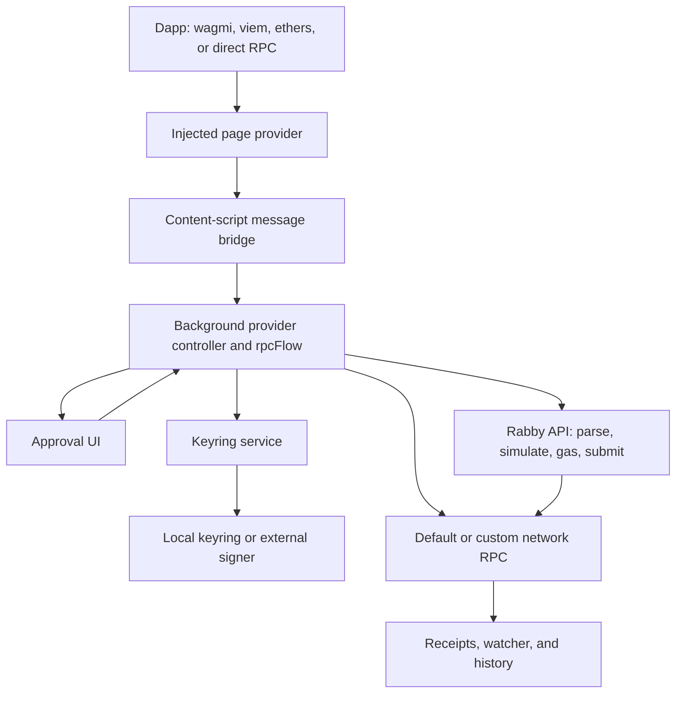

# Rabby architecture and Monad native transaction integration

Research snapshot: **2026-11-11**. Implemented scope: **canonical encoding, decoding, ECDSA signing, hashing, and opt-in baseline RPC integration for `0x40` through `viem/monad`**, plus the **Rabby custom-development-network milestone** on `feat/monad-type-40-wallet`. The Viem RPC work is committed and pushed on `feat/monad-universal-transactions`. Both use canonical signing output and three-field submissions with empty auxiliary data. The wallet milestone excludes authorization lists, sponsorship, batching, and nonempty auxiliary data. Live-node interoperability remains unverified.

The four client-action integration issues identified by the [RPC review](#rpc-review-findings-2026-11-11) have been fixed with regression coverage and pushed in commit [40e3a58c1](https://github.com/haythemsellami/viem/commit/40e3a58c1c8c9c0326558eee8991992173059ea4) to the existing fork PR. The canonical codec and submission helpers retain the main design’s two-field identity and three-field submission contract.

The wallet milestone is available in [Rabby PR #1](https://github.com/haythemsellami/Rabby/pull/1), reviewed at commit `a7138ba36ed58ff9974d74dde4b34af0d3b9a81a`. The [wallet review fixes](#wallet-review-fixes-2026-11-12) for queued approval activation, RPC-change invalidation, and receipt-driven history refresh are implemented on `feat/monad-type-40-wallet`.

This reference combines the Rabby architecture/dependency overview with the deeper Tempo and Base implementation investigation. It is an implementation map, not a finalized Monad transaction specification. Viem and development-wallet implementation boundaries are identified below; integrated-network wallet support and additional transaction features remain future work.

The supplied [universal transaction draft](proposals/monad-universal-transaction-draft.md) is the primary proposal for Monad's wire format. The user selected its **main injection-based design** for implementation and explicitly excluded auxiliary data from the offline milestone. The exact source copy still includes the unselected alternative. Tempo/Base remain comparison material, not specifications for `0x40`.

## Navigation

- [Evidence and repository versions](#evidence-and-repository-versions)
- [Universal transaction proposal and immediate Viem scope](#universal-transaction-proposal-and-immediate-viem-scope)
- [Baseline RPC integration](#baseline-rpc-integration)
- [Rabby baseline integration using the Viem implementation](#rabby-baseline-integration-using-the-viem-implementation)
- [Architecture and execution contexts](#architecture-and-execution-contexts)
- [Dependencies and their responsibilities](#dependencies-and-their-responsibilities)
- [Transaction lifecycle](#transaction-lifecycle)
- [Rabby ecosystem and signer coverage](#rabby-ecosystem-and-signer-coverage)
- [Tempo protocol implementation](#tempo-protocol-implementation)
- [Tempo in viem and Ox](#tempo-in-viem-and-ox)
- [Tempo in Rabby](#tempo-in-rabby)
- [Base transaction design and SDK work](#base-transaction-design-and-sdk-work)
- [Concrete Monad implementation map](#concrete-monad-implementation-map)
- [Dapp API, viem, and wagmi](#dapp-api-viem-and-wagmi)
- [Monad protocol decisions](#monad-protocol-decisions)
- [Delivery sequence and acceptance criteria](#delivery-sequence-and-acceptance-criteria)
- [Verification and maintenance](#verification-and-maintenance)
- [Primary sources](#primary-sources)

## Evidence and repository versions

| Component | Inspected baseline | Evidence boundary |
| --- | --- | --- |
| Local Rabby fork | `0.94.15`, commit `f525b02218aae8f47311ede20bc13e62afea8f27`, dated 2026-11-05 | Primary basis for the wallet file map |
| Rabby's pinned viem | `2.47.6` | The version used by Rabby and SimpleKeyring; its Tempo behavior was inspected and exercised offline |
| Ox under that viem | `0.14.7` | Implements the pinned Tempo envelope codec |
| Separate local viem fork | `2.57.18`, base commit `417f2ebc6ccdb504432c1c1bd96939bb55748c9a`; Ox `0.14.65` | Offline module at `049793af38c7afcaeae8aee084686f5f01aa2eb2`, RPC integration at `40e3a58c1c8c9c0326558eee8991992173059ea4`, on `feat/monad-universal-transactions`, available in [draft PR #1](https://github.com/haythemsellami/viem/pull/1) |
| SimpleKeyring | `5.1.2`; public source commit `83b46a4ab9ae47a229255d83fd7db378d931bd3a` | Tempo signing branch inspected |
| HDKeyring | `4.3.7` | Manifest and inheritance from SimpleKeyring inspected |
| Tempo node | `4f3a1e0a8cf01724677e2026fe1b36fad0743770` | Transaction signing, batch execution, and fee-manager source inspected; this is a source snapshot, not proof of deployment |
| Base viem proposal | `wevm/viem#5004`, head `7061819d9c37da53ee8e38dcfe29b9742360ff20` | Open, unmerged at research time |
| Base viem hash follow-up | `chunter-cb/viem#2`, head `6f4bc0c24f05cc6bd91c2b867f78c6f022ef67a0` | Open draft at research time |
| EIP-8430 proposal | `ethereum/EIPs#12385`, inspected head `2a481e6471e521d76b22703d5469165168c7ac01` in `chunter-cb/EIPs` | Open proposal; distinguish it from the Base reference page and implementation revisions |

The separate local viem checkout does **not** change Rabby's installed dependency. A source change in that checkout needs an explicit package/link/build integration before Rabby can use it.

Local file links below are relative to this document so the reference can move with the repository. Line numbers are navigation hints for the Rabby snapshot, not permanent identifiers. Use the named symbols when positions drift.

Backend internals, production sponsor policy, and hardware firmware behavior were not available in this investigation. Frontend API calls establish required interfaces; they do not prove the backend implementation behind them.

## Universal transaction proposal and immediate Viem scope

Source: [supplied proposal](proposals/monad-universal-transaction-draft.md), received 2026-11-11. This is a draft, not evidence of network activation. The first, offline milestone covers the main design's two-element canonical envelope and baseline ECDSA signing. The subsequent [RPC milestone](#baseline-rpc-integration) adds preparation, RPC formatting, and submissions with empty auxiliary data. New transaction features and nonempty auxiliary data remain excluded.

### Format and commitment boundaries

```text
canonical transaction = 0x40 || rlp([chain_id, features])
transaction hash       = keccak256(canonical transaction)

Separate formats, not accepted by the canonical Transaction codec:
submitted transaction = 0x40 || rlp([chain_id, features, auxiliary_data])
receipt               = 0x40 || rlp([status, cumulative_gas_used,
                                    logs_bloom, logs, receipt_extensions])
```

Feature maps use unique ascending one-byte keys. Auxiliary data and receipt extensions have their own ordered maps. Feature, auxiliary, execution-input, consensus-input, and receipt-extension registries must remain separate where the proposal defines separate namespaces.

Auxiliary data is excluded from the draft's canonical transaction hash and transaction-trie object. The canonical Transaction codec rejects a three-element envelope, including an empty auxiliary list; the later Submission module handles exactly the empty-list submission form. Raw receipt-envelope encoding is not implemented. This implements the requested scope; it is not a claim about a deployed node's submission contract. Consensus and execution inputs remain separate future objects.

For baseline sender ECDSA signing, retain feature `0x06` and replace its value with the RLP empty list before hashing the canonical transaction. In an ordinary recursive RLP encoder, the value is `[]`, which encodes to `0xc0`; it is not a byte string containing `0xc0`. After signing, insert `[yParity, r, s]` and compute the signed canonical transaction hash.

### Existing features for the first milestone

| Key | Existing semantic field | Baseline handling |
| --- | --- | --- |
| `0x01` | Account nonce, uint64 | Encode/decode exactly; keep full-width values out of unsafe JavaScript number conversions |
| `0x02` | Gas limit, uint64 | Encode/decode; gas estimation is deferred to RPC integration |
| `0x03` | Single call | Nested DEST/VALUE/DATA fields; include ordinary contract creation with empty destination |
| `0x04` | Access list | Optional existing semantics; absent means empty according to the draft |
| `0x05` | Authorization list | Optional existing delegation semantics where the target node supports them |
| `0x06` | Sender ECDSA signature | Baseline signing payload, signature insertion, and recovery to verify the selected account |
| `0x07` | Inclusion gas bid | Existing EIP-1559 fee-cap semantics |

Batch calls, sponsorship, encrypted transactions, MCP, flexible authentication, storage-charge features, APES, scheduled transactions, and anonymous transactions are outside this first milestone. Their unassigned symbolic keys must not be invented by the SDK.

### Implemented codec boundary

- A lossless envelope parser/serializer preserves unknown feature values as RLP data and validates structural canonicality, including key ordering and duplicates. It must not sort malformed received transactions into a different valid transaction.
- A typed baseline builder interprets the supported existing features and emits a canonical `0x40` transaction. Familiar `to`, `value`, and `data` inputs can map to the CALL feature.
- Baseline signing validation is separate from structural parsing. A future encrypted or scheduled transaction can lack fields required by the baseline cleartext EOA profile and still need to be parsed and retained as opaque data.
- Local signing rejects unsupported feature combinations until their signing rules are implemented. Forward-compatible decoding is not permission to sign a partially understood transaction. A generic raw broadcast transport can still forward already signed bytes without claiming semantic support.
- The canonical serializer emits exactly two outer elements. Signing clears only the baseline sender-signature value, and hashing includes all canonical feature values. Submission serialization belongs to the separate Submission module.
- The opt-in [baseline RPC integration](#baseline-rpc-integration) adds chain-specific request, transaction, receipt, and full-block formatting, including full-width nonces in embedded transactions.
- The dedicated `viem/monad` namespace owns the codec inside Viem, using existing Ox primitives. Generic Ethereum serializer/parser dispatch and chain defaults remain unchanged. The RPC milestone extends shared actions with opt-in chain hooks and typing; Rabby still needs its own integration.

In local Viem `2.57.18`, `src/accounts/utils/signTransaction.ts` hashes the serializer's unsigned output and calls it again with the signature. The initial Monad API instead uses `Transaction.sign`, which explicitly calls the local account's raw signer and inserts the signature. **Do not pass `Transaction.serialize` directly as an account serializer:** it does not implement that second-argument signature-insertion contract. `getSerializedTransactionType` still rejects `0x40`. Forwarding bytes with `sendRawTransaction` alone is not complete new-type SDK support.

### Public API and source map

Implementation: [`viem/src/monad/Transaction.ts`](../../viem/src/monad/Transaction.ts). Public entry point: [`viem/monad`](../../viem/src/monad/index.ts). Usage and reference: [module overview](../../viem/site/pages/docs/monad/index.mdx) and [transaction API](../../viem/site/pages/docs/monad/transactions.mdx).

| API | Responsibility |
| --- | --- |
| `Transaction.from(fields)` | Build ordered baseline features from familiar fields, with an empty signature list by default |
| `Transaction.serialize(envelope)` | Validate and encode the canonical envelope; never sort malformed input |
| `Transaction.deserialize(bytes)` | Check canonical RLP, exact outer arity, key order, and present known-field shapes; preserve unknown values |
| `Transaction.getSignPayload(envelope)` | Require the supported baseline and hash it with feature `0x06` replaced by `[]` |
| `Transaction.sign({ account, transaction })` | Snapshot the envelope, sign the digest, verify recovery against the account address, normalize to low-s, and return signed bytes |
| `Transaction.hash(envelope)` | Hash the canonical bytes, including signatures and unknown feature values |

The decoded model is `{ chainId: bigint, features: readonly [Hex, Value][] }`, where `Value` is a byte string or recursive RLP list. It has no auxiliary-data field. Known integer widths and address/storage-key lengths are checked even when other features are unknown. Missing fields remain missing during structural decoding.

The internal [RLP codec](../../viem/src/monad/internal/rlp.ts) and value validation use explicit stacks, with no fixed nesting limit. Decoding enforces minimal RLP lengths, complete input consumption, and parent-list boundaries before reading child values. Encoding rejects cyclic arrays and permits shared acyclic arrays. Ox still provides byte-string RLP encoding, hex conversion, hashing, and ECDSA primitives; no dependency version change is required.

Low-s normalization applies only to newly produced sender signatures in `sign`: after recovery verification, `s > n / 2` becomes `n - s` and recovery parity is flipped. `from`, `serialize`, `deserialize`, and `hash` preserve supplied signatures exactly, so parsing an existing transaction cannot change its hash. Authorization signatures are not rewritten.

The baseline builder uses bigint for nonce, gas, fees, amounts, and authorization integers. It accepts a safe number or bigint chain ID and returns bigint. Defaults are zero value, empty data, and empty destination for creation. Optional lists distinguish absence from an explicitly encoded empty list. Baseline signing requires features `0x01`, `0x02`, `0x03`, `0x06`, and `0x07`; the call requires all three fields. Unknown top-level or call-field keys are rejected for signing.

```ts
import { privateKeyToAccount } from 'viem/accounts'
import { Transaction } from 'viem/monad'

// Deterministic test key; never use it for funds.
const account = privateKeyToAccount(
  '0x0000000000000000000000000000000000000000000000000000000000000001',
)
const transaction = Transaction.from({
  chainId: 143,
  nonce: 7n,
  gas: 21_000n,
  to: '0x0000000000000000000000000000000000000002',
  value: 1_000_000_000_000_000_000n,
  maxPriorityFeePerGas: 2_000_000_000n,
  maxFeePerGas: 50_000_000_000n,
})
const digest = Transaction.getSignPayload(transaction)
const serialized = await Transaction.sign({ account, transaction })
const decoded = Transaction.deserialize(serialized)
const hash = Transaction.hash(decoded)
```

This illustrative fixture produces sender digest `0x28c7c329dfe2c25987d0c4039f187bcd972562f301bfdf474d9cda9c695272ba` and signed transaction hash `0x1af324647ba3a40fd6e4836eb9896d6c424256b4cdb2d88f0c02a01894105a5b`. Tests cross-check the encoding and signing with ethers; these are not node-supplied golden vectors or proof that the example gas limit is executable.

### Architecture comparison behind the module decision

The user selected a dedicated module after comparing the implementations on 2026-11-11. Neither inspected implementation adds its new transaction type to Viem's generic byte serializer/parser:

- Tempo exposes `Transaction.serialize`/`deserialize` from `viem/tempo`, delegates the envelope primitives to `ox/tempo/TxEnvelopeTempo`, and registers a custom serializer through its chain configuration. Normal local-account client actions pass this serializer to the account. Current source: [Transaction](https://github.com/wevm/viem/blob/417f2ebc6ccdb504432c1c1bd96939bb55748c9a/src/tempo/Transaction.ts), [chain configuration](https://github.com/wevm/viem/blob/417f2ebc6ccdb504432c1c1bd96939bb55748c9a/src/tempo/chainConfig.ts).
- Chris's Base proposal owns its codec and signing helpers inside `viem/eip8130`, using Viem RLP/hash primitives. `toEoaAccount` supplies custom account signing; `eip8130ChainConfig` integrates self-paid requests and receipts. Shared changes adapt RPC type mapping, transaction response shape, and receipt waiting. Source: [upstream PR #5004](https://github.com/wevm/viem/pull/5004), still open at inspection.
- Base's [hash follow-up #2](https://github.com/chunter-cb/viem/pull/2), still an open draft, proposes authorization-independent identity. Monad retains the supplied draft's `keccak256(canonical signed transaction)` rule.

Monad follows the module boundary and standalone signing approach. Later client support can use chain/account adapters without changing this codec API or making a new Ox release a prerequisite.

### Decisions still needed from the draft or node implementation

1. Confirm the outer chain ID's width with the node. The codec assumes uint256, matching existing EVM transaction practice; the draft does not explicitly assign its width. Integers use minimal unsigned RLP encoding.
2. Reconcile consensus validity rules with the node: ECDSA scalar/low-s acceptance, maximum executable nonce, and authorization/creation restrictions. Structural parsing checks encoded widths, not all execution rules. The SDK signing policy is settled: verify the produced ECDSA signature against the selected account and normalize to low-s, including for custom signers. Node acceptance of received high-s transactions remains a separate protocol question.
3. Confirm node compatibility with the selected SDK RPC contract: standard fields and methods, three-field submissions with an empty auxiliary list, and canonical transaction identity. Nonempty auxiliary data remains deferred; node deployment and interoperability have not been established.
4. Supply independently generated node vectors and freeze intrinsic-gas behavior before network integration. The main encoding and dedicated module boundary are already selected; they are not pending decisions.

### First-milestone completion criteria

Encode, decode, sign, verify sender recovery, and hash ordinary baseline envelopes offline. Cover contract creation, optional access/authorization lists, unknown-field preservation, canonical key rules, integer bounds, empty-list versus byte-string encoding, and existing Ethereum transaction regressions. Submission, transaction reads, receipts, and compatible-node checks belong to the next milestone.

Verification completed on 2026-11-11:

| Check | Result |
| --- | --- |
| [Monad transaction tests](../../viem/src/monad/Transaction.test.ts) and [internal RLP tests](../../viem/src/monad/internal/rlp.test.ts) | 116 passed; includes low-s normalization with both parities, 16,384-level nesting, cycle rejection, 1,000 generated RLP comparisons, and independent ethers/EthereumJS boundary vectors |
| Ethereum codec/signing regression selection | 285 passed across seven files including Monad; one existing RPC preparation test excluded because this was an offline run |
| Monad coverage, including internal RLP | 100% statements (213/213), branches (125/125), functions (26/26), and lines (206/206) |
| [Public type tests](../../viem/src/monad/Transaction.test-d.ts) | Two discovered and passed with no source errors |
| `pnpm check:types` | Passed after building the repository's generated contract fixtures |
| `pnpm build` | Passed the clean CommonJS, ESM, and declaration build sequence |
| Built package imports | ESM and CommonJS `viem/monad` imports both normalized high-s signatures, retained the original signed fixture hash, and round-tripped 16,384-level nested values |
| Documentation examples | All 17 new Twoslash examples passed against built declarations; the full documentation site was not built |
| Focused Biome and diff checks | Passed |
| `pnpm check:repo` | Exit 0; existing warning about missing `test/package.json` remains |

Reproduce the offline runtime selection from the Viem repository:

```sh
SKIP_GLOBAL_SETUP=true pnpm test --run --project core \
  --coverage '--coverage.include=src/monad/**/*.ts' \
  --testNamePattern='^(?!.*w/ prepareTransactionRequest)' \
  src/monad/Transaction.test.ts \
  src/monad/internal/rlp.test.ts \
  src/utils/transaction/serializeTransaction.test.ts \
  src/utils/transaction/parseTransaction.test.ts \
  src/utils/transaction/getTransactionType.test.ts \
  src/utils/transaction/getSerializedTransactionType.test.ts \
  src/accounts/utils/signTransaction.test.ts
```

The default type-test command did not discover `.test-d.ts` files. Verification temporarily set core-project `typecheck.enabled` and `typecheck.only` to true, set runtime `include` to `[]`, and used an explicit Monad type-test path and a targeted tsconfig extending `test/tsconfig.json` with `composite: false`; those temporary settings were restored afterward. A run relying on the top-level CLI flag alone unexpectedly started runtime suites and was stopped. Generated declarations must follow JavaScript builds: `check:types` and JavaScript builds can include duplicate `Window.ethereum` declarations if `src/_types` is present. Run `pnpm clean` before checking types, then use the normal `pnpm build` sequence. These are tooling constraints, not remaining implementation blockers.

The offline Viem implementation, tests, and site documentation were committed as `049793af38c7afcaeae8aee084686f5f01aa2eb2` (`feat(monad): add type 0x40 transaction primitives`) on `feat/monad-universal-transactions`. That milestone contained 20 files. The branch is pushed to `haythemsellami/viem` and available for review in [draft PR #1](https://github.com/haythemsellami/viem/pull/1), targeting the fork's `main`; the current [diff](https://github.com/haythemsellami/viem/pull/1/files) also includes the later RPC commit documented below. No compatible Monad node or node-authored golden vectors were used. Sponsorship, batching, and Rabby signing integration remain outside the implemented scope.

### Pre-commit design review (2026-11-11)

The review found no mismatch in the supported baseline's canonical envelope, integer encoding, sender digest, or signed transaction hash. Feature `0x06` remains present with an empty RLP list in the signing preimage. The signed transaction hash includes the signature. Auxiliary data remains excluded by the selected implementation scope.

Both review findings have been addressed:

1. **Nested-value robustness, fixed.** A canonical 12,093-byte envelope with 4,096 nested lists overflowed Ox's recursive codec. Validation, list encoding, and decoding now use explicit stacks. Regression tests exercise 4,096 and 16,384 levels, unknown call fields, shared acyclic lists, cycle rejection, and an independently constructed deeply nested wire value. No protocol depth limit was introduced.
2. **Sender low-s policy, implemented.** A custom signer's high-s output previously passed recovery and was returned unchanged. `sign` now verifies recovery and normalizes it to low-s with parity correction. Regression tests cover both recovery parities and require identical bytes and transaction hashes from equivalent low-s and high-s signer outputs. Received high-s signatures still round-trip unchanged through the structural codec. The draft does not explicitly require low-s; this is the selected SDK signing policy, with node acceptance rules still to be confirmed.

A further 10,000 byte-mutation checks against the updated codec accepted 7,143 structurally valid envelopes and rejected 2,857. Every accepted result also passed independent EthereumJS decoding and exact re-encoding, and its transaction hash matched ethers. These exploratory checks supplement the regression tests in the repository.

Original review checks, performed before the fixes and without adding these exploratory cases to CI:

| Check | Result |
| --- | --- |
| Existing Monad runtime suite | 83 passed again |
| 2,000 generated baseline envelopes | Exact bytes, signing digests, and hashes matched an independently assembled ethers encoding; EthereumJS RLP decoding also matched |
| 100 generated signed envelopes | Deterministic signatures, recovered sender, serialized bytes, and signed hashes matched ethers |
| Calldata length boundaries | 17 lengths from zero through 65,536 bytes passed, including short/long RLP prefix transitions |
| Opaque values and key boundaries | 1,000 generated envelopes and an envelope containing all 256 one-byte feature keys passed round trips |
| 10,000 byte mutations | 5,493 accepted results also passed independent strict decoding and exact re-encoding; 4,507 were rejected |

The chain-ID uint256 assumption and lack of node-authored golden vectors remain as documented above. Neither broad baseline validity checks nor this review establishes network acceptance. Both fixes are included in commit `049793af38c7afcaeae8aee084686f5f01aa2eb2`.

## Baseline RPC integration

Status: **committed and pushed** in [40e3a58c1](https://github.com/haythemsellami/viem/commit/40e3a58c1c8c9c0326558eee8991992173059ea4), on top of `049793af38c7afcaeae8aee084686f5f01aa2eb2`. The selected contract uses standard RPC fields and methods, canonical signing output, and exactly three submission fields with empty auxiliary data. The scope is the existing single-call baseline, paid by its sender, with ECDSA authentication. Sponsorship, batching, encryption, and nonempty auxiliary data remain deferred. No compatible node or node-authored RPC fixtures have been supplied for interoperability verification.

The existing `sendRawTransaction` action forwards arbitrary serialized hex to `eth_sendRawTransaction` and returns the node's hash. The new adapters let a configured Viem client prepare, sign, submit, read, and track the baseline type. Most live in `viem/monad`, following the chain configuration pattern used by Tempo. Generic Ethereum parsing and serialization remain unchanged. No Ox, Rabby, or wagmi changes are required by this local-account implementation.

### Implemented API and boundaries

| Surface | Implementation |
| --- | --- |
| [chainConfig](../../viem/src/monad/chainConfig.ts) | Opt in with `defineChain({ ...monad, ...chainConfig })`; select `type: 'monad'` explicitly. Existing mainnet/testnet definitions and automatic type inference remain unchanged. |
| [Formatters](../../viem/src/monad/Formatters.ts) | Standard request/transaction/receipt fields, RPC `type: '0x40'`, bigint nonce and authorization quantities, and mixed-type full blocks. Response formatter metadata preserves public-client TypeScript inference while direct formatting bypasses number-based base conversions. |
| [Canonical account serializer](../../viem/src/monad/internal/transaction.ts) | Unsigned invocation encodes feature `0x06` as `[]`; signed invocation inserts the signature, checks the supplied sender context, and normalizes low-s. Both produce two-field canonical bytes. Unsupported baseline request fields fail explicitly. |
| [Submission](../../viem/src/monad/Submission.ts) | `serialize(envelope)` adds the empty third list. `deserialize(bytes)` accepts exactly three fields with empty auxiliary data and returns the canonical envelope. Both reuse iterative RLP processing. |
| Combined send | `sendTransaction` signs canonically and then invokes `transactionEnvelope` to produce network bytes. |
| Standalone sign and send | `canonical = await wallet.signTransaction(request)`; `submitted = Submission.serialize(Transaction.deserialize(canonical))`; pass `submitted` to generic `sendRawTransaction`. |
| Nonce preparation | Reads pending nonce with raw RPC and converts directly to bigint. Explicit nonces are preserved. Number-based nonce managers require an explicit bigint nonce; generic `getTransactionCount` retains its existing number return type. Sender-and-nonce lookup accepts `number | bigint` without loss of precision. |
| Receipt tracking | Uses canonical hashes and standard sender/nonce replacement matching. Dropped transactions accept caller-provided bigint nonce context for nonce-slot lookup, with block scans when the method is unavailable. Tests also cover still-queryable transactions and receipt refresh after reorganization. |

The shared changes recognize already-filled bigint nonces, preserve Monad creation destinations in estimation and both send actions, and honor explicit chain overrides in request formatting and serialization. Gas estimation accepts a typed chain override; sender/nonce lookup and dropped-transaction context accept bigint nonces. Synchronous timeout recovery hashes Monad canonical signing output. Generic Ethereum parser/type dispatch is unchanged.

RPC lookup fields must preserve the distinction between omitted and explicitly empty optional lists. An optional `raw` response field carries structurally validated canonical bytes; use `Transaction.deserialize(raw)` and `Transaction.hash` for identity. RPC fields are node-provided data, and formatters do not independently verify their consistency with `raw`. Prepared requests reject `raw`/`features` input rather than maintaining two mutable transaction representations.

Signing requires a local ECDSA account that honors the custom serializer contract. JSON-RPC account signing/sending fails explicitly for this type; adding this configuration to a dapp does not add signing support inside Rabby. `eth_fillTransaction` is optional, with standard fee/estimation fallback. Node gas schedules, executable nonce limits, and creation/authorization validity still require interoperability confirmation.

The [RPC guide](../../viem/site/pages/docs/monad/rpc.mdx) documents public usage. [HTTP integration tests](../../viem/src/monad/chainConfig.test.ts) run against an ephemeral protocol fixture with independent ethers RLP, signature recovery, and hash verification; it does not execute the EVM or implement Monad consensus. [Submission tests](../../viem/src/monad/Submission.test.ts), [formatter tests](../../viem/src/monad/Formatters.test.ts), and [type tests](../../viem/src/monad/chainConfig.test-d.ts) cover the adapter boundaries.

Verification of RPC commit [40e3a58c1](https://github.com/haythemsellami/viem/commit/40e3a58c1c8c9c0326558eee8991992173059ea4) (including the review fixes):

| Check | Result |
| --- | --- |
| Monad runtime suite | 154 passed across five files, including existing canonical codec and iterative RLP tests |
| Selected Ethereum and Monad regressions | 341 passed across thirteen files in the final targeted run, including all Monad tests and selected Ethereum codec/formatter regressions |
| Monad module coverage | 100% statements (305), branches (225), functions (43), and lines (289) |
| Public type tests | 16 passed across five files, including chain overrides, bigint lookups/replacement callbacks, existing Ethereum inference, and typed transaction/full-block reads |
| Full TypeScript check | Passed |
| Package build | CJS, ESM, and declaration builds passed |
| Built public exports | ESM and CJS signing, submission round trips, and bigint request formatting passed |
| Documentation | All 51 Twoslash examples passed across Monad and the three touched public-action guides, against generated declarations; an existing missing `parseEther` import in the gas-estimation example was corrected |
| Formatting and repository state | Biome and whitespace checks passed; the Viem working tree is clean after committing and pushing |

The adapter also accepts recovery IDs `0`/`1` and `27`/`28` when a signer supplies `v`, rejects invalid recovery IDs, and verifies supplied sender context before normalizing low-s. The preserved main proposal's SHA256 remains `79ce4f8c4910a71e3a2932c1083312577e2ef99774a98ddba081bf20face1cb9`.

### RPC review findings (2026-11-11)

Review status: **all four findings fixed and pushed** in [40e3a58c1](https://github.com/haythemsellami/viem/commit/40e3a58c1c8c9c0326558eee8991992173059ea4). Regression tests first reproduced ten failing cases across the four findings, then passed after correction. Tests use real ephemeral HTTP servers, actual Viem clients, and independent ethers decoding, signature recovery, and hashing. No compatible Monad node has been supplied for interoperability verification.

| Finding | Implemented correction | Regression coverage |
| --- | --- | --- |
| Synchronous timeout recovery hashed submission bytes | [sendTransactionSync](../../viem/src/actions/wallet/sendTransactionSync.ts) hashes the signed canonical Monad bytes when code 4 supplies no hash. Node-provided hashes retain precedence; existing Ethereum and blob-wrapper handling is preserved. | Immediate receipts, code-4/no-hash recovery, code-4/with-hash recovery, and ordinary Ethereum recovery; actual submissions contain three fields and an empty auxiliary list. |
| Synchronous sending could change creation into a call | The sync action applies the same Monad destination rule as ordinary sending. Omitted and null destinations remain empty in the canonical call feature, including with authorizations. | Both destination forms with a valid signed authorization; sync and ordinary sends match standalone canonical signing, destination, value, and creation receipt. |
| Per-action chain overrides lost the explicit type | [estimateGas](../../viem/src/actions/public/estimateGas.ts) uses the effective chain for preparation and formatting; both send actions use the effective request formatter. Nested gas preparation forwards the chain. | Fill-supported and fallback preparation, normal and synchronous sending, estimation with block context, and JSON-RPC account rejection through chain overrides. Type tests cover inferred Monad fields. |
| Custom replacement hook disabled dropped-transaction recovery | Removed the redundant custom nonce key. [getTransaction](../../viem/src/actions/public/getTransaction.ts) and [waitForTransactionReceipt](../../viem/src/actions/public/waitForTransactionReceipt.ts) accept bigint nonce inputs at the lookup/recovery boundary, preserving standard sender/nonce semantics. | Dropped Monad transactions at the uint64 maximum and ordinary Ethereum transactions, both with nonce-slot lookup and method-unavailable block-scan fallback; zero nonce lookup, callback fields, existing pending transactions, and reorganization checks also pass. |

Implementation decisions:

- Preserve the agreed wire and signing contract; no new transaction feature or generic Ethereum parser dispatch was added.
- Extend gas estimation's public types to accept a chain override, so downstream actions use the same chain configuration as signing. This selects formatting and preparation; it does not switch transports.
- Widen sender/nonce lookup to `number | bigint`; derive replacement nonce inputs and callback transaction types from the configured chain. Configured Monad clients support bigint recovery context, while ordinary Ethereum callback nonces retain their number types. Existing number callers remain valid. Generic `getTransactionCount` and nonce managers still use numbers; their broader redesign is outside this change.
- Existing OP Stack gas wrappers already forwarded a chain; their four obsolete type-error suppressions were removed now that gas estimation accepts it.
- Use the canonical bytes already returned by the Monad signer for sync timeout recovery. No new chain hashing hook is required for this baseline.
- Retain custom replacement-key behavior for chains with different nonce semantics, such as Tempo. Monad's baseline consumes an ordinary sender/nonce slot.

The final targeted suite uses the normal test configuration. A separate run with `TEST_RLP=true` exhausted Node’s default heap in existing generic large-list stress tests; that opt-in suite is excluded by default and was left unchanged. Monad-specific nested-RLP regressions remain included and pass.

Independent checks that passed during review:

- 300 baseline cases compared the account serializer's unsigned preimage and final signed canonical bytes with independently assembled ethers RLP and ECDSA signatures. Cases varied nonce/gas boundaries, amounts, calldata lengths, destinations, and optional-list presence.
- Those cases also compared three-field submissions byte-for-byte and verified that hashing the decoded canonical envelope matches the signed canonical hash and differs from hashing network bytes.
- Another 300 opaque-envelope cases exercised submission RLP length transitions, including the short/long prefix boundary.
- Feature `0x06` remains present with an empty list during signing, low-s normalization retains recovery parity correctly, and the wrapper appends an actual empty list. No mismatch was found in these core operations.

An inherited Viem behavior was also confirmed: standalone wallet `signTransaction` resolves `chainId` from RPC and overwrites a supplied request chain ID. For example, a request with `chainId: 144` on the configured chain/network `143` is signed with `143`; preparation rejects that mismatch. This is separate from the four integration findings. Explicit mismatch rejection would make the two entry points consistent; offline `Transaction.sign` already uses the envelope's supplied chain ID directly.

The optional RPC `raw` field is only structurally decoded, and node-reported hashes/flat fields remain trusted RPC data. Live-node vectors are still required to confirm the node's canonical hash, field-presence conventions, gas schedule, and executable validity rules.

### Selected contract and remaining node questions

| Decision | Selected SDK behavior or remaining node question | Why it matters |
| --- | --- | --- |
| Bytes accepted by `eth_sendRawTransaction` | Exactly `0x40 || rlp([chain_id, signed_features, []])`. The SDK does not rely on a two-field shorthand. | The canonical codec deliberately accepts only two fields; the submission module accepts three. Adding the empty third element changes the bytes, although it does not change the canonical transaction identity. |
| Standard methods versus new methods | Existing `eth_sendRawTransaction`, `eth_estimateGas`, `eth_call`, transaction lookup, block, and receipt methods with an explicit `0x40` type. | The SDK selects standard methods. The node must implement the same contract; the preserved draft originally left transaction lookup open. |
| Request JSON | Familiar fields (`from`, `to`, `data`, `nonce`, `gas`, fee caps, optional access/authorization lists) with `type: '0x40'`. | Confirm unsigned simulation defaults with the node. Explicit empty lists differ from omitted features; RPC quantities and canonical RLP values use different encodings. |
| Response JSON and lossless reconstruction | Standard fields with preserved optional-list presence and optional canonical `raw` bytes. | An absent optional list feature and a present empty list can execute equivalently but have different signed bytes and hashes. The SDK does not accept `raw` or a feature map as mutable request fields. |
| Explicit selection and activation | Use JavaScript `type: 'monad'`, mapped to RPC `type: '0x40'`, on an opt-in configured chain/client. Preserve ordinary Ethereum types. | Merely adding a Monad chain ID does not establish network support. Never silently downgrade an explicitly requested `0x40` transaction to another type. |
| Signing output versus network output | Canonical output from both `Transaction.sign` and configured `signTransaction`; explicit `Submission.serialize` for standalone sending. | The post-sign envelope hook covers combined `sendTransaction` and `sendTransactionSync`. Generic `sendRawTransaction` forwards bytes unchanged, so standalone callers must encode submission bytes first. |
| Numeric widths and account rules | Keep the baseline nonce as `bigint` through RPC conversion and preparation, preserving its uint64 encoding range. Preserve authorization nonce uint64 and authorization chain ID uint256. Confirm the maximum executable nonce, outer chain-ID width, signature acceptance, and authorization/creation restrictions with the node. | Several existing Viem paths use JavaScript numbers. The encoder's width checks do not establish all consensus-valid values. Known Monad client chain IDs fit a number, but that does not make arbitrary authorization chain IDs safe to convert. |
| Gas, fees, and simulation | Use the draft's EIP-1559-style fee fields, with node-defined intrinsic gas and `0x40` estimation/simulation. Confirm the applicable fee RPCs, defaults, and error responses. Treat `eth_fillTransaction` as optional. | Do not assume the draft's illustrative 21,000-gas transfer is a final intrinsic-gas rule, or copy another chain's fee constants. An unsigned estimation request needs an explicit contract, including `from` and creation behavior. |
| Signer support | Start with local ECDSA accounts that support the adapter's signing contract. | Injected wallets and node-managed `eth_signTransaction`/`eth_sendTransaction` must independently support the type. Configuring a dapp client does not add it to Rabby or hardware wallets. |

The user selected this SDK contract after the RPC design review. The earlier exclusion of auxiliary data applied to the offline codec; the RPC implementation adds only the empty wrapper. This selection is not evidence that a deployed node accepts it.

### Lifecycle and signing invariants

```text
Explicit baseline request, type: 'monad'
  -> prepare nonce, gas, and EIP-1559-style fee caps
  -> build ordered baseline features with feature 0x06 present as []
  -> sign keccak256(0x40 || rlp([chain_id, unsigned_features]))
  -> insert [yParity, r, s] into feature 0x06
  -> canonical = 0x40 || rlp([chain_id, signed_features])
  -> submitted = 0x40 || rlp([chain_id, signed_features, []])
  -> eth_sendRawTransaction(submitted)
  -> returned hash must equal keccak256(canonical)
  -> transaction/block/receipt reads and receipt waiting use that hash
```

The final wrapping step implements the selected three-field RPC contract. Decode and re-encode the canonical fields when deriving identity from submitted bytes; do not truncate a suffix or hash the submitted bytes. Actual auxiliary payloads and their feature-specific validation remain deferred.

Viem's local private-key signing utility invokes its serializer twice: once without a signature and once with one. A new adapter must return **canonical signing-preimage bytes, not a digest**, on the first invocation; the utility performs the hash. On the second invocation it must insert the signature and return the selected signed representation. The existing `Transaction.serialize` cannot serve as this adapter unchanged. Preserve the selected low-s signing policy and account/signature checks where applicable, including custom signer coverage, rather than assuming the old standalone tests establish adapter correctness.

### Viem implementation map

The implementation surfaces above realize this map. Source links below retain the generic extension points and constraints that were inspected before implementation.

| Area | Responsibility | Existing source |
| --- | --- | --- |
| Public request and response types | Add baseline JavaScript/RPC types, explicit `monad`/`0x40` selection, safe quantities, nullable pending fields, and separate canonical/submission representations. Keep a single authoritative prepared representation; build features after preparation rather than retaining a stale feature map alongside mutable fields. | [Monad module](../../viem/src/monad/index.ts), [chain types](../../viem/src/types/chain.ts) |
| Account serializer adapter | Map familiar fields through the existing codec, handle the unsigned and signed serializer invocations, and delegate ordinary Ethereum types to the existing serializer. Retain the standalone codec's validation and signing policies. | [account signing](../../viem/src/accounts/utils/signTransaction.ts), [Monad codec](../../viem/src/monad/Transaction.ts) |
| Submission encoder and send paths | The dedicated encoder adds an empty third list. `serializers.transactionEnvelope` handles combined local sending; standalone callers use `Submission.serialize`. Generic `sendRawTransaction` forwards already prepared network bytes. | [chain serializers](../../viem/src/types/chain.ts), [sendTransaction](../../viem/src/actions/wallet/sendTransaction.ts), [signTransaction](../../viem/src/actions/wallet/signTransaction.ts), [sendRawTransaction](../../viem/src/actions/wallet/sendRawTransaction.ts) |
| Request formatter and preparation | Map the chosen JSON schema for sending, `eth_estimateGas`, and `eth_call`; preserve explicit type and caller-supplied values; fill nonce/gas/fees safely; handle optional `eth_fillTransaction` without losing the type. Define creation and authorization-list behavior explicitly. | [request formatter](../../viem/src/utils/formatters/transactionRequest.ts), [preparation](../../viem/src/actions/wallet/prepareTransactionRequest.ts), [fillTransaction](../../viem/src/actions/public/fillTransaction.ts), [estimateGas](../../viem/src/actions/public/estimateGas.ts), [call](../../viem/src/actions/public/call.ts) |
| Transaction formatter | Recognize `0x40`, preserve the authoritative representation, retain absent versus empty features, decode quantities safely, and expose consistent sender/signature and pending/mined fields. Delegate other transaction types. | [base transaction formatter](../../viem/src/utils/formatters/transaction.ts), [Tempo formatter pattern](../../viem/src/tempo/Formatters.ts) |
| Block formatter | Format embedded full transaction objects through the Monad-aware formatter, including mixed Ethereum/Monad blocks; preserve hash-only block responses. | [base block formatter](../../viem/src/utils/formatters/block.ts), [Tempo chain configuration](../../viem/src/tempo/chainConfig.ts) |
| Receipt formatter and tracking | Recognize the receipt type while retaining ordinary status, logs, gas and creation fields. Agree on any extension fields before adding them. Verify receipt waiting, replacement, and reorg handling with the canonical hash and full-width nonce. No RLP receipt codec is required merely to format JSON receipts. | [receipt formatter](../../viem/src/utils/formatters/transactionReceipt.ts), [receipt waiting](../../viem/src/actions/public/waitForTransactionReceipt.ts) |
| Chain configuration and exports | Add opt-in formatters, preparation hooks, serializers, and public exports under `viem/monad`; decide how users configure the existing mainnet/testnet definitions without automatically enabling a speculative type. | [Monad chain](../../viem/src/chains/definitions/monad.ts), [Monad testnet](../../viem/src/chains/definitions/monadTestnet.ts), [Tempo chain configuration](../../viem/src/tempo/chainConfig.ts) |
| Narrow shared compatibility changes | Where custom types or uint64 nonces cannot pass through existing generic action contracts safely, add a scoped adapter/action or a narrowly tested shared change. Avoid assuming that casting away a number-based type fixes runtime behavior. | [getTransactionCount](../../viem/src/actions/public/getTransactionCount.ts), [nonce manager](../../viem/src/utils/nonceManager.ts), [sender-and-nonce transaction lookup](../../viem/src/actions/public/getTransaction.ts) |

Official Viem documentation describes [chain formatters](https://viem.sh/docs/chains/formatters) and [transaction serializers](https://viem.sh/docs/chains/serializers). The envelope-hook and numeric-path findings above are based on the pinned local source, which must be rechecked after rebasing.

### Source-level pitfalls found during inspection

1. **The envelope hook is not universal.** The local `sendTransaction` path invokes `serializers.transactionEnvelope` after signing. Standalone `signTransaction` does not, and `sendRawTransaction` forwards its input without invoking a serializer or calculating a hash. Viem's documented [prepare/sign/sendRaw sequence](https://viem.sh/docs/actions/wallet/sendRawTransaction) therefore requires an explicit `Submission.serialize` step for Monad.
2. **An ordinary transaction formatter override can run too late.** `defineFormatter` invokes the base formatter before applying overrides. The base transaction formatter decodes nonce with `hexToNumber`, which rejects values above the safe integer range. Authorization chain IDs and nonces use `Number`, which can lose precision. Follow Tempo's direct formatting pattern for `0x40` instead of letting these conversions happen first.
3. **Full-block reads have their own path.** The base block formatter calls the global transaction formatter for every embedded transaction. Installing only a chain transaction formatter does not fix full blocks; the chain block formatter must dispatch those transactions itself.
4. **Fetching and managing nonces need separate attention.** `getTransactionCount` returns a number and the generic nonce manager is number-based. Sender-and-nonce lookup now accepts bigint at runtime, and configured Monad receipt tracking preserves full-width nonce context. A full-width codec alone does not make preparation or receipt replacement lookup full-width. Use a bigint-aware path or deliberately constrain and document any temporary support boundary; never silently round a nonce.
5. **Preparation can change the intended type or fields.** Without an explicit type, ordinary fee/authentication fields infer Ethereum types. Preparation opportunistically attempts `eth_fillTransaction` before fallback RPCs; any supported fill response needs Monad-aware formatting. If both raw features and flat fields are returned, later fee/nonce overrides must not leave the features stale.
6. **Creation is not merely an omitted `to`.** Existing send/estimate logic can infer a destination from an authorization list when `to` is absent. Confirm the node's creation-plus-authorization rules and preserve explicit creation intent instead of accidentally inferring an authority address.

### Acceptance criteria and external dependencies

Use independent byte/signature/hash vectors and real RPC exchanges against a compatible node to verify:

- A sender-paid transfer and contract call complete preparation, signing, submission, lookup, full-block reading, receipt reading, and receipt waiting; exercise creation and optional existing list features according to the agreed node rules.
- Both the combined send path and the documented standalone sign/submission path produce the expected network bytes. The node's returned hash, lookup hash, and receipt hash match the signed canonical hash, including when the submission carries an empty third list.
- Missing versus explicit empty features round-trip losslessly where reconstruction is promised; RPC quantities such as `0x0` are not confused with minimal RLP integer byte strings such as `0x`.
- Nonce values above `2^53 - 1`, uint64 boundaries, authorization widths, caller-supplied fields, pending nonces, chain mismatch, simulation errors, unsupported types, and malformed submission envelopes behave explicitly without precision loss or type fallback.
- Mixed-type blocks, pending/mined responses, replacement, and reorg behavior work, and existing Ethereum transactions retain their behavior.
- Runtime checks and public TypeScript inference cover the configured client, actions, serializer adapter, and exports. Current codec tests remain regression coverage but do not prove RPC integration.

The SDK contract is selected and implemented. A compatible endpoint and independently generated node vectors are still required to demonstrate interoperability. The RPC code, tests, and site documentation are committed as `40e3a58c1c8c9c0326558eee8991992173059ea4` and pushed to the existing fork PR.

## Rabby baseline integration using the Viem implementation

Status: **development milestone implemented on `feat/monad-type-40-wallet`, 2026-11-11**. Repository: [haythemsellami/Rabby](https://github.com/haythemsellami/Rabby), based on `develop`. The user selected a custom development network, local keyrings, and explicit exclusion of authorization lists, sponsorship, and batching. The implementation below covers that scope. The original investigation map is retained afterward to distinguish this milestone from full integrated-network support.

### Development milestone implementation

The implemented entry point is dapp `eth_sendTransaction` with `type: '0x40'` on a custom network whose chain ID exactly matches the build-time `MONAD_DEV_CHAIN_ID`. Support is disabled when this variable is absent. Integrated chains, internal send/MiniSign flows, external signers, and alternate type spellings are rejected for this milestone. Existing Ethereum transactions and Tempo retain their existing paths and Viem version.

| Implementation | Responsibility |
| --- | --- |
| [Monad request adapter](../src/utils/monad.ts) | Strict field allowlist, canonical JSON quantities, full uint64/uint256 widths, optional access-list presence, single call/creation, approved-intent comparison, signed-result recovery, and canonical/submission conversion through `viem/monad`. Rejects authorization lists even when empty. |
| [Local keyring subclasses](../src/background/service/keyring/monad.ts) | Add the Monad branch to Rabby's existing SimpleKeyring/HDKeyring subclasses. Key retrieval stays within the keyring module. Both return `{ kind: 'monad', canonicalSerializedTransaction }`. Ordinary transactions delegate to their existing SimpleKeyring implementation. No published keyring package was patched or upgraded. |
| [Preparation/submission service](../src/background/service/monad.ts) | Verify the RPC chain; read pending nonce/balance; fill missing fee fields; estimate the actual `0x40` request through the fork's request formatter; sign the approved fields; store canonical identity; submit the empty-auxiliary envelope. Concurrent submissions for one account/chain reject before a second signature. |
| [Approval view](../src/ui/views/Approval/components/SignMonadTx.tsx) and [routing](../src/ui/views/Approval/components/SignTx.tsx) | Separate development approval selected before either existing transaction screen can normalize fields. Displays exact sender, destination/creation, value, data, access list, nonce, gas, tip, fee cap, and maximum network fee. Fields are read-only in this milestone. Clearly identifies that RPC gas estimation is available and asset-change simulation is not. |
| [Provider flow](../src/background/controller/provider/rpcFlow.ts) and [controller](../src/background/controller/provider/controller.ts) | Gate the original request, bind the approval ID and session version in process, retain blocked-address checks, and dispatch before EthereumJS construction or generic type rewriting. A changed nonce or fee requires a new approval; existing automatic retry mutations are refused for this type. |
| [Session version](../src/background/service/monadSession.ts) | Invalidate Monad consent on lock/unlock, account changes, relevant site permission/chain changes, custom-network changes, RPC override replacement/removal, and approval cancellation. Asynchronous network edits invalidate both when validation starts and when the configuration takes effect. Check again before signing and before broadcast, including after asynchronous signing. No session token is accepted from dapp parameters. |
| [History](../src/background/service/transactionHistory.ts), [nonce utilities](../src/utils/transactionNonce.ts), and [watcher](../src/background/service/transactionWatcher.ts) | Persist Monad group nonces as exact decimal strings; retain number compatibility for existing records. Use exact comparisons and normalized lookup keys. Store canonical bytes, submission bytes, and canonical hash. Poll/reconcile receipts with that hash and exact nonce. Custom-network watcher IDs retain the complete chain suffix. |
| [Custom-network history](../src/ui/views/TransactionHistory/TestnetTranasctionHistory.tsx) and [history rows](../src/ui/views/TransactionHistory/components/TransactionItem.tsx) | Show pending as well as completed development transactions; refresh on receipt/history events for the displayed account and on account changes. Offer exact-byte rebroadcast for pending Monad transactions; disable existing speed-up/cancel paths that would construct another envelope. |

The implementation deliberately bypasses the old `SignTestnetTx` field/number normalization instead of widening its shared gas editor. Existing `signTxPreparation` backend simulation is not used. A new private UI-to-background preparation call reads the active `SignTx` approval itself, verifies its identity/account, and rejects stale completion. The page provider needs no package change.

**Package decision:** a built fork artifact is vendored under [vendor](../vendor/README.md) and installed as `viem-monad`, with source revision and SHA-256 documented there. The installed graph was verified: Rabby and published SimpleKeyring still resolve Viem `2.47.6`; the new adapter resolves the fork at `2.57.18` / commit `40e3a58c1`. Its `ox@0.14.65` dependency needed one exact-version exception to Yarn's 15-day age gate. The general gate and disabled dependency build scripts remain in place. SimpleKeyring/HDKeyring pins and their existing resolution override remain unchanged.

**Nonce and failure policy:** automatic preparation starts from the RPC's pending nonce and skips only exact locally reserved pending nonces. Explicit stale/pending nonces reject. The controller rechecks nonce availability before signing and does not modify an approved request. Once broadcast is about to be attempted, history retains the signed canonical identity even if the RPC times out, reports an already-known transaction, or returns a mismatched hash. These errors are not proof of execution. Exact-byte rebroadcast validates stored bytes, signature, hash, selected account, session, and network before sending the same submission; it does not sign or estimate again. Receipt polling determines execution status. Fee/nonce replacement and automatic gap-filling are deferred.

**Development use:** register a custom network with the compatible node endpoint and native currency metadata, then build with its decimal chain ID. For example:

```sh
NODE_OPTIONS=--max-old-space-size=12288 MONAD_DEV_CHAIN_ID=31337 yarn build:dev
```

Load the resulting development extension, import a disposable funded development key or mnemonic, connect a dapp to that custom network, and issue a direct provider request:

```ts
await ethereum.request({
  method: 'eth_sendTransaction',
  params: [{
    type: '0x40',
    from,
    to,
    value: '0x0',
    data: '0x',
  }],
})
```

Nonce/gas/fees may be supplied as canonical hex quantities or filled before approval. Omit `to` or use `null` for creation. `accessList: []` remains distinct from an omitted access list. Missing fee caps are prepared from the pending block's base fee and RPC priority-fee suggestion; this is a wallet estimate, not a protocol constant. A node lacking those methods can be used with explicit fee fields if it supports the remaining required RPC methods.

No new protocol decision was needed. The remaining external blocker is a compatible Monad node and node-authored vectors. Production backend simulation, internal wallet actions, authorization-list approval, hardware/external wallets, and typed injected-wallet Viem actions remain separate milestones. The dedicated approval screen is a development UI, not production UX parity with Rabby's integrated networks.

**Validation (2026-11-11):** `yarn check` passed (source lint and full TypeScript check). The focused regression run passed **201 tests across 17 suites**, including all six [Monad suites](../__tests__/monad), existing custom-network Ethereum signing, transaction utilities, custom-network service, permission/session changes, notification lifecycle/queue behavior, approval identity/submit behavior, and gas UI. Tests exercise the real local keyrings and actual HTTP transport; independent ethers RLP/Keccak/recovery checks verify signing preimages, canonical hashes, and empty-auxiliary submission framing.

The Chrome MV3 development extension compiled successfully with `MONAD_DEV_CHAIN_ID=31337` and an explicit 12 GiB Node heap. The final one-shot check used `MANIFEST_TYPE=chrome-mv3 yarn webpack --env config=dev --no-watch` after the normal development build's clean/theme steps. Webpack reported one dynamic-dependency warning in the existing `ox/_cjs/tempo/internal/virtualMasterPool.js` import. `yarn build:dev` starts watch mode; verification watchers were stopped after compilation. Whitespace checks passed for the implementation and reference; the preserved source draft retains its original trailing spaces. The vendored SDK and preserved design-draft hashes were reverified. During commit preparation on 2026-11-12, `yarn` and `yarn check` passed again with no additional dependency changes.

The existing `__tests__/service/keyring.test.ts` suite could not load because Jest cannot resolve the ESM-only `@ledgerhq/device-transport-kit-web-hid` package. A diagnostic test-only mock advanced to a second ESM-only dependency (`multiformats`); that mock was removed and the legacy suite remains unchanged. The passing Monad signer tests cover imported keys, mnemonic/passphrase accounts, and ordinary Ethereum/Tempo signing, but do not replace the full keyring-service suite. Resolving its broader loader setup is separate work.

A compatible node is still required for a live injected-provider, approval, broadcast, and receipt round trip; the local HTTP test is a protocol fixture, not a node implementation.

### Wallet review fixes (2026-11-12)

The review of Rabby PR #1 at `a7138ba3` found three lifecycle gaps. The fixes below are on the same branch; no Viem package or protocol encoding change is required.

| Finding | Fix | Regression coverage |
| --- | --- | --- |
| A queued Monad request never received its approval ID/session binding because `onCurrent` was dropped while queued. | [Notification service](../src/background/service/notification.ts) retains each callback privately and invokes it once on first activation, whether immediate, promoted after settlement, or recovered with the notification window. Resuming or reopening an already activated approval does not rerun the callback. | [Queue tests](../__tests__/service/notificationQueue.test.ts) cover resolve/reject/force-reject promotion, preemption/resumption, reopening, callback failure, and whole-queue cancellation. [Provider tests](../__tests__/monad/provider.test.ts) exercise the real request flow, notification service, provider controller, and local signer through queued approval and canonical submission; expired promoted approvals cannot be renewed by reopening. |
| RPC overrides did not expire approvals, and network edits invalidated only before asynchronous validation. | [Custom-network service](../src/background/service/customTestnet.ts) invalidates the existing Monad session version before installing/removing an RPC override and again when a validated network edit commits. Metadata/configuration edits also expire consent when an override keeps the effective client unchanged. | [Network tests](../__tests__/monad/network.test.ts) cover override replacement/removal, approvals opened during asynchronous validation, enabled overrides, unsuccessful validation, and RPC replacement during nonce checks or signing. Stale consent cannot reach broadcast. |
| The custom-network history fetched once, leaving mined transactions displayed as pending. | The history view listens for account-scoped `RELOAD_TX` events, reloads on account changes, and associates results with their account so late responses cannot restore another account's history. | [History UI tests](../__tests__/monad/historyUi.test.ts) cover pending-to-confirmed/reverted updates, case-insensitive account matching, unrelated events, unmount cleanup, account switching with an outstanding request, and removal of the current account. |

**Lifecycle decisions:** the existing global Monad session counter also acts as the custom-network configuration revision. RPC or network changes conservatively expire outstanding activated Monad approvals; sending afterward requires a new approval. A queued request acquires its ID/session binding when it first becomes active, before preparation and explicit user confirmation. Activation is not consent, and reactivation must never refresh a prior session binding. Callback storage stays in the background process rather than in the UI approval payload.

Canonical signing, low-s normalization, signed two-field transaction hashing, and three-field submission with empty auxiliary data retain the existing contract. Authorization lists, sponsorship, batching, and nonempty auxiliary data remain excluded.

**Validation (2026-11-12):** `yarn --immutable` passed with the existing peer-dependency warnings and no manifest/lockfile changes. `yarn check` passed source lint and the full TypeScript check. The broader regression selection passed **264 tests across 23 suites**, including all eight Monad suites, notification activation/settlement/window lifecycle, approval identity and UI guards, permission changes, custom-network service and gas behavior, existing Ethereum signing, and transaction utilities. The four changed/new test suites contribute 21 additional regression cases.

A clean Chrome MV3 development build passed after `yarn clean` and `yarn make-theme`, using `MONAD_DEV_CHAIN_ID=31337 MANIFEST_TYPE=chrome-mv3 NODE_OPTIONS=--max-old-space-size=12288 yarn webpack --env config=dev --no-watch`. The existing Ox Tempo `virtualMasterPool.js` dynamic-dependency warning remains. Whitespace checks passed, the vendored SDK and preserved design-draft SHA-256 values are unchanged, and the installed Viem/keyring versions still match the pinned milestone. Live-node interoperability remains unverified; the previously documented full keyring-service Jest loader limitation remains outside these lifecycle fixes.

The central change is a Monad transaction adapter through Rabby's request, approval, keyring, and broadcast paths. Installing the Viem fork does not activate those paths: Rabby does not delegate its entire transaction lifecycle to a Viem wallet client, and its generic signer/broadcaster still constructs EthereumJS transactions. The existing Tempo branch identifies useful extension points, but several routes still reconstruct transactions with EthereumJS and must not be copied unchanged.

### Dependency changes and evidence

| Component | Current evidence | Development implementation / remaining work |
| --- | --- | --- |
| Rabby Viem dependency | `package.json` pins `2.47.6`; the fork with Monad support is based on `2.57.18` | The `viem-monad` alias installs a built, pinned archive of commit `40e3a58c1`. Existing Viem imports remain at `2.47.6`. |
| `@rabby-wallet/eth-simple-keyring` | `5.1.2`, source `83b46a4ab9ae47a229255d83fd7db378d931bd3a`; pins its own Viem `2.47.6` | Rabby's `PrivateKeyKeyring` subclass adds the Monad branch using the alias. The published package and its Viem pin remain unchanged; ordinary Ethereum/Tempo signing still delegates to that package. |
| `@rabby-wallet/eth-hd-keyring` | Published `4.3.7` package, git head `f0d4608eb8af7f1e58067d120ff23715ea213c03`; `index.ts:63` extends SimpleKeyring and pins SimpleKeyring `5.1.2` | The `MnemonicKeyring` subclass uses the same Monad signing helper and existing key derivation/passphrase support. Real mnemonic/passphrase signing is tested; no published dependency update was needed. |
| Package pins / lockfile | Rabby also has a SimpleKeyring `resolutions` entry | Only the alias and its transitive lock entries were added. Existing keyring pins and resolution overrides remain intact; installed versions were verified. |
| `@ethereumjs/tx`, ethers, Ox | Existing Ethereum transaction paths and general primitives | No new envelope implementation is required in these packages if every `0x40` route uses `viem/monad`. Keep ordinary Ethereum support intact. |
| `@rabby-wallet/page-provider` | Published `0.4.11`, git head `121efd9ffd3146f7d943a1a4f68c7b27f66f532c`; bundled `_request` forwards request data to the bridge | No package change was needed for the standard request. Provider-controller tests cover approval-to-submission behavior; a full injected-provider/browser round trip remains part of live-node validation. |
| `@rabby-wallet/rabby-api` | Published `0.9.69`, git head `3afa83eb812f44f86e9e3076f9882cdffce4e84b`; `Tx` lacks `type`, access-list, and authorization-list declarations | A local typed Monad request adapter handles the development flow. Backend parse/pre-execution/submission endpoints are bypassed; production backend integration remains open. |
| `rabby-action`, security engine | Existing single-call action interpretation | No package changes in this milestone. The development approval displays raw call/creation fields and discloses the lack of asset-change simulation; production semantic interpretation remains open. |
| wagmi | Not Rabby's transaction signing stack | No Rabby wagmi change is required. Dapp convenience integration is a separate boundary described below. |

Rabby's [Yarn configuration](../.yarnrc.yml) disables dependency build scripts and limits Git dependencies. The development implementation selected a reproducible built tarball under a separate alias, used by both the wallet adapter and its local keyring subclasses. A future global upgrade remains a wider compatibility change.

Published package evidence was inspected directly from the immutable versioned archives for [HDKeyring](https://registry.npmjs.org/@rabby-wallet/eth-hd-keyring/-/eth-hd-keyring-4.3.7.tgz), [page-provider](https://registry.npmjs.org/@rabby-wallet/page-provider/-/page-provider-0.4.11.tgz), and [rabby-api](https://registry.npmjs.org/@rabby-wallet/rabby-api/-/rabby-api-0.9.69.tgz). SimpleKeyring's [pinned signing implementation](https://github.com/RabbyHub/eth-simple-keyring/blob/83b46a4ab9ae47a229255d83fd7db378d931bd3a/index.js#L263) was also rechecked. The original investigation used manifest/lockfile evidence; the subsequent development implementation installed and verified the dependency graph described above.

### Transaction lifecycle and byte ownership

```text
Dapp eth_sendTransaction({ type: '0x40', standard fields })
  -> validate configured chain + account support + request fields
  -> prepare exact nonce/gas/fees and parse the single call
  -> existing Rabby approval, bound to that transaction and session
  -> SimpleKeyring / inherited HDKeyring signing with viem/monad
       canonical = 0x40 || rlp([chainId, signedFeatures])
  -> background decodes and checks the signed result
       hash       = Transaction.hash(decodedCanonical)
       submission = Submission.serialize(decodedCanonical)
                  = 0x40 || rlp([chainId, signedFeatures, []])
  -> eth_sendRawTransaction(submission)
  -> reconcile the returned hash with the canonical hash
  -> history, receipt polling, and replacement tracking use canonical hash
```

Use JSON hex quantities through the dapp/extension/storage boundaries and convert to `bigint` inside the adapter. Wire requests use `type: '0x40'`; the Viem request model uses `type: 'monad'`. Do not pass the wire discriminator unchanged into a generic Viem request formatter and assume it will select the Monad path.

The signing implementation belongs inside the keyring, where key retrieval already occurs. The following shows responsibilities, not a complete proposed patch:

```ts
// Inside the keyring: account and approvedFields stay within the signing boundary.
const canonicalSerializedTransaction = await Transaction.sign({
  account,
  transaction: Transaction.from(approvedFields),
})
return { kind: 'monad', canonicalSerializedTransaction }

// In the background after verifying the signed result matches the approval:
const signed = Transaction.deserialize(result.canonicalSerializedTransaction)
const transactionHash = Transaction.hash(signed)
const submission = Submission.serialize(signed)
```

The result must be a discriminated **object**. In [provider controller](../src/background/controller/provider/controller.ts), around line 1099, a bare string returned by a signer is treated as the hash of an already-broadcast transaction. Returning canonical bytes as that string would skip the intended broadcast path and corrupt transaction identity.

Retain the keyring service's existing `signTransaction` boundary and pairing/credential handling. Do not export keys into the controller or UI, use public `eth_sign`/`personal_sign` as a substitute for transaction signing, or re-prepare fields after approval. `Transaction.sign` supplies signature recovery checks and low-s normalization; the background must also bind the signed transaction to the approved sender, chain, and fields.

Wrap the canonical bytes exactly once at the transport boundary. Every supported submission route should consume the same submission bytes. Avoid r/s/v reconstruction with EthereumJS, hashing submission bytes, or treating a transport timeout as permission to rebuild a different transaction. A hash mismatch is an interoperability error requiring reconciliation, not a reason to replace the local identity with the submission hash.

### Concrete Rabby changes

| Area and source | Observed behavior | Required `0x40` change |
| --- | --- | --- |
| New shared adapter, following the existing Tempo helper organization | No Monad request model or signer result exists | Define the validated baseline request, explicit type/activation checks, lossless numeric conversion, approved-intent comparison, keyring result, and canonical/submission conversion. Reuse Viem for the protocol codec. |
| [Transaction utilities](../src/utils/transaction.ts), `normalizeTxParams`, `buildSignTx`, `buildParseTxRequest`, `applySelectedGasToTx` | Explicit field picks drop access lists; `buildSignTx` does not preserve the request's tip there; parse requests select type 2/4; gas helpers can add `gasPrice` or strip authorizations | Preserve all supported fields and optional-list presence. Retain `0x40` through preparation, disallow legacy fee fallback, and keep JSON quantities lossless. Unsupported authorizations must reject explicitly, not disappear. |
| [Provider routing](../src/background/controller/provider/rpcFlow.ts), `ethSendTransaction` preparation | Normalizes requests, attaches approval preparation, and coordinates account/session checks | Select the Monad adapter before generic normalization can discard intent. Explicitly gate the chain and signer; retain existing permission and approval lifecycle. No new wallet RPC method is necessary. |
| [Integrated approval](../src/ui/views/Approval/components/SignTx.tsx), around lines 1729–1839 | Rebuilds a selected field set; waiting-signer results use `type` for keyring identity | Preserve the baseline request and keep wire transaction type separate from UI keyring metadata. Show the ordinary call, sender-paid MON fees, destination/value/data, and chain. Recalculate/reapprove when fields change. |
| [Custom-network approval](../src/ui/views/Approval/components/SignTestnetTx/index.tsx), around lines 215–300 and 797 | Separate component; initial state and final approved object omit the transaction type and optional lists | Update this path explicitly. Fix exact nonce/fee handling, preserve creation destination semantics and access lists, and use the configured Monad estimation path. Fixing `SignTx.tsx` alone does not fix custom networks. |
| [Provider controller](../src/background/controller/provider/controller.ts), around lines 704, 749–838, 877–998 | Deletes UI `type`; may turn equal fee cap/tip into legacy; forces type 2 or 4; constructs an EthereumJS transaction outside Tempo | Dispatch Monad from a validated, approval-bound discriminator. Exclude it from legacy/type-2/type-4 rewriting and EthereumJS construction. Route to the local Monad keyring branch and consume its explicit canonical result. |
| Same controller, submission branches around lines 1122, 1212, 1240, and 1305 | Custom RPC and custom-testnet routes construct EthereumJS bytes; default RPC has a Tempo special case and a backend fallback | Use the prepared Monad submission bytes on each enabled route. Do not silently fall back to another type or an unverified backend route. Integrated backend reporting must accept the canonical identity too. |
| [Keyring service](../src/background/service/keyring/index.ts), `signTransaction`, around line 924; external SimpleKeyring | Delegates signing into the selected keyring | Preserve the delegation boundary, add the SimpleKeyring branch, and return a typed result. Restrict the initial path to SimpleKeyring and HDKeyring. |
| [Internal sends](../src/ui/utils/sendTransaction.ts) and [MiniSign](../src/ui/component/MiniSignV2/services/SignatureSteps.ts) | Separate field copying, type selection, fee, and nonce handling | Route enabled internal flows through the same adapter. For a dapp-only first milestone, explicitly leave these flows unavailable for `0x40`; do not claim all wallet send/swap/bridge paths are supported. |
| [Preparation service](../src/background/service/signTxPreparation.ts) | Integrated networks use backend `parseTx` and `preExecTx`; preparation is cached per approval | Ensure cached results describe the exact type, nonce, gas, fees, and call approved later. Preserve cancellation and invalidation on edits/session changes. A Viem chain config alone does not replace this service. |
| [Custom-network service](../src/background/service/customTestnet.ts), `createClientByChain`, `estimateGas`, `getTransactionCount`, `parseTx` | Constructs a generic Viem chain; count returns a number; estimation passes the existing tx object | Opt in to the Monad formatters for supported networks and map wire fields to the SDK model. Fetch nonce as a raw RPC quantity/BigInt rather than using the generic number-returning count helper. Keep local single-call parsing. |
| [Nonce helpers](../src/background/controller/walletUtils/sign.ts) and [wallet controller](../src/background/controller/wallet.ts), `getCustomTestnetNonce` | Ordinary path queries `latest` plus local pending history; custom-network helper converts the maximum to a number | Use an agreed pending-nonce policy with local reservations/concurrency handling and lossless quantities. No Tempo nonce-key precompile is involved. Confirm endpoint pending semantics. |
| [History](../src/background/service/transactionHistory.ts) and [watcher](../src/background/service/transactionWatcher.ts) | History groups have numeric nonces; add/update/watch paths call `Number(nonce)` | Preserve uint64 nonce identity, sorting, increment, matching, and persistence. Use exact quantity strings with BigInt comparisons and compatibility reads for existing records. Keep the canonical hash, typed request, and canonical bytes sufficient for inspection/retry. |
| OpenAPI client, server, and indexing | Parse/pre-execution/submit/history contracts are shared with ordinary Ethereum types | For integrated Monad UX, confirm or extend acceptance of `0x40`, its decoder, gas/execution simulation, canonical hashing, receipt/history indexing, and fallback behavior. Client-side type changes do not implement server support. |

Wide values affect more than nonce: the approval gas editors currently use number-based prices and rounding. Keep exact `gas`, `value`, fee-cap, tip, and optional authorization quantities in the transaction model; display conversions must not flow back into signed values without an explicit user edit. A deliberate safe-integer-only prototype would need explicit rejection and documented limits; silent rounding is unacceptable.

Do not advertise hardware, WalletConnect, Safe, Cobo, or watch-only signing support from the local-keyring work. Each signer needs its own transaction-format support and approval semantics. An unsupported signer should receive a clear error before signing begins, without a fallback to blind hash signing.

### Custom-network proof versus integrated Rabby support

There are two materially different paths:

1. **Custom-network proof:** `SignTxWrap` selects `SignTestnetTx`; its explanation uses `parseCustomNetworkTx`, backed by `customTestnetService.parseTx`, and its gas estimate uses the configured RPC. `rpcFlow` skips the integrated background preparation prefetch for custom networks. This makes a useful first path for local-keyring signing and direct raw submission without extending the production parse/pre-execution/submission backend. Existing metadata/security lookups can still use services; this is not a claim that Rabby runs entirely offline. Local parsing plus estimation does not provide Rabby's full backend asset-change simulation.
2. **Integrated Monad network:** ordinary `SignTx` and background preparation use the Rabby APIs; broadcast can use direct RPC plus backend reporting/fallback. Production-quality support needs these service contracts validated or extended. Selecting a custom RPC URL for an already integrated chain does **not** switch it to the custom-network approval screen or remove backend dependencies.

Neither path may simulate a transaction relabeled as type 2 and present that as verified execution of type `0x40`. Execution fields may be familiar, but intrinsic gas, envelope validation, and network activation belong to the node contract. Unsupported or unavailable simulation must remain visible through the wallet's existing handling, and signing must not bypass approval checks.

### Dapp entry point and the current Viem limitation

Rabby can receive the baseline request through the existing provider method after its wallet implementation is added:

```ts
await ethereum.request({
  method: 'eth_sendTransaction',
  params: [{
    type: '0x40',
    from,
    to,
    value: '0x0',
    data: '0x',
    maxFeePerGas,
    maxPriorityFeePerGas,
  }],
})
```

This is a proposed test entry point, not a statement that current Rabby accepts/signs it. The connected wallet chain determines the network; any supplied chain ID must match. The wallet can prepare missing nonce/gas before approval using the compatible node.

Our current [Monad request formatter](../../viem/src/monad/Formatters.ts), around lines 192–202, intentionally throws for JSON-RPC-account `sendTransaction` and `signTransaction`. Therefore, attaching the current `chainConfig` to a dapp `createWalletClient({ transport: custom(rabbyProvider) })` is not sufficient. This guard does not prevent Rabby from using the codec with its own local keyrings. For the first wallet proof use the direct EIP-1193 request above. For typed `walletClient.sendTransaction({ type: 'monad' })` through Rabby, add a separately tested wallet-facing Viem formatter/configuration or capability-gated remote-account path; do not remove the guard globally before compatible wallets exist. wagmi can consume that later without becoming Rabby's signer.

### Recommended first milestone and remaining decisions

Recommended first delivery: an explicitly enabled custom development network, dapp `eth_sendTransaction`, SimpleKeyring and HDKeyring, a single ordinary call or creation, sender-paid fees, optional access lists, and an empty auxiliary list. Keep existing Ethereum transaction selection as the default; chain ID or EIP-1559 support alone does not prove `0x40` activation. Disable unsupported gas-account/gasless, batching, and special submission modes for this explicit type.

Existing authorization lists are supported by the Viem baseline codec but pass through separate Rabby EIP-7702 approval/revocation logic. For the first wallet proof, explicitly reject them unless that approval path is included and tested; do not strip them or reinterpret the outer transaction as type 4. This is a proposed narrower wallet capability, not a limitation of the codec or a new transaction feature. Complete parity with all existing codec fields requires that subsequent authorization integration.

| Decision or dependency | Recommendation / impact |
| --- | --- |
| Activation and network | Opt-in configuration tied to an explicit development chain/endpoint, with ordinary Ethereum types unchanged. Need a compatible node before claiming interoperability. |
| Package integration | For an isolated prototype, use one built, commit-pinned fork artifact under an alias in both wallet and SimpleKeyring; decide separately whether to replace Rabby's global Viem pin. |
| Initial signer / entry-point coverage | Local imported-key and mnemonic accounts, dapp request, custom-network approval first. Integrated networks, internal MiniSign flows, and external signers must be separately enabled and tested. |
| Existing authorization lists | Reject explicitly in the smallest wallet milestone, or include the existing authorization approval/revocation work now if complete codec parity is required. |
| Numeric compatibility | Prefer lossless quantity storage for Monad throughout history and replacement tracking. Decide the compatibility migration before changing persistent records. |
| Dapp SDK convenience | Direct provider requests first; a remote-account Viem path is additional SDK work after Rabby can sign the type. |
| Node and backend | Node-authored vectors plus a compatible endpoint are the current interoperability blocker. Integrated Rabby service support is unverified and requires service-owner coordination; it does not block a custom-network adapter with fixtures. |

No new consensus encoding or signing design is needed for this wallet plan: use the selected main design and the existing canonical/submission distinction. The unresolved items are integration scope, distribution, persistence compatibility, and live node/service availability.

### Acceptance tests for the wallet integration

| Boundary | Required evidence |
| --- | --- |
| Provider and preparation | Preserve explicit `0x40`; reject wrong chain/unsupported signer/features; retain fee cap and tip, zero values, contract creation, access lists, and absent-versus-empty list presence. Test both ordinary and custom-network approval entry points when enabled. |
| Approval and signing | A fresh approval covers the exact final fields; nonce/gas edits invalidate stale preparation. Lock/unlock/account/chain changes and mismatched approval IDs/components cannot authorize signing. Both local keyring types sign the same independently verified payload. |
| Numeric limits | No rounding above `Number.MAX_SAFE_INTEGER`; check nonce/gas uint64 and fee/value uint256 boundaries, malformed quantities, zero nonce, storage reload, sorting, and replacement identity. Reject unsupported authorization input without mutation. |
| Bytes and hash | Compare canonical bytes, sender recovery, low-s signature, submission bytes, and canonical hash with Viem fixtures and independent node vectors. Assert the submission has exactly three fields and empty auxiliary data, and its direct keccak hash is not used as transaction identity. |
| Routing and failure | Test every enabled custom/default RPC and custom-network branch. Retries reuse exact bytes; mismatched RPC hashes, already-known transactions, timeouts, and disabled backend fallback reconcile against the canonical identity. |
| History and regressions | Receipt polling uses canonical hash; successful/failed transactions and reload preserve type and nonce. Existing Ethereum transactions and Tempo signing retain their behavior after package integration. |

The original investigation changed only this reference. The subsequent development implementation and its verification are described at the start of this section. No public keyring release or live-node `0x40` broadcast has been performed.

## Architecture and execution contexts

Rabby is a browser-extension wallet with separate page, content-script, background, UI, and hardware-bridge contexts. The background services own wallet operations. Dapp libraries are outside the wallet and talk to its provider.



| Context | Responsibility | Source entry points |
| --- | --- | --- |
| Page provider | EIP-1193 request/events, wallet discovery including EIP-6963, page-facing compatibility | [page-provider import](../src/content-script/page-provider.ts), external `@rabby-wallet/page-provider` |
| Content script | Bridges page requests into extension messaging; does not hold signing keys | [content-script entry](../src/content-script/index.ts) |
| Background provider controller | Handles dapp RPC requests after routing, account/chain/permission checks, and approval | [rpcFlow](../src/background/controller/provider/rpcFlow.ts), [provider controller](../src/background/controller/provider/controller.ts) |
| Background wallet controller | Exposes wallet operations to internal UI, including swaps, bridges, and account operations | [wallet controller](../src/background/controller/wallet.ts) |
| Background services | Keyring vault, permissions, sessions, notification approvals, RPC, backend API, preparation, history, and watchers | [service exports](../src/background/service/index.ts) |
| UI | Popup, tab, and transaction approval views; renders parsed actions, simulation, fees, and signer state | [SignTx](../src/ui/views/Approval/components/SignTx.tsx), [MiniSign services](../src/ui/component/MiniSignV2/services/SignatureSteps.ts) |
| Offscreen/device bridges | Device transport and APIs that need a different execution context | [offscreen entry](../src/offscreen/scripts/offscreen.ts), [keyring implementations](../src/background/service/keyring/index.ts) |

The Chrome build uses Manifest V3 and a service worker; Firefox has a separate manifest/build path. Build entries include background, content script, page provider, UI, and offscreen code. Some older repository documentation describes a persistent background page; consult the current [manifest](../src/manifest/chrome-mv3/manifest.json) and [build configuration](../build/webpack.common.config.js) before relying on those lifecycle details.

Private keys and mnemonic keyrings belong to the background keyring/vault boundary. UI preferences and other persisted services have different storage and synchronization requirements. New transaction support should not move private keys into a dapp, approval component, or sponsor client.

The page provider is primarily a request/event interface. Adding a transaction format there does not implement signing. Conversely, adding a codec to the background does not automatically add a new wallet RPC method.

## Dependencies and their responsibilities

The extension has **no direct wagmi dependency or wagmi-based signing path** in the inspected source. Wagmi references in the lockfile include optional peers from another dependency; they are not evidence that Rabby's signer uses wagmi.

| Dependency | Pinned version | Role in the extension |
| --- | --- | --- |
| `viem` | `2.47.6` | RPC/ABI/account utilities and the dedicated Tempo transaction integration |
| `ox` through pinned viem | `0.14.7` | Tempo transaction envelope, signatures, and hashing primitives |
| `ethers` | `5.8.0` | Ethereum utilities and integrations elsewhere in the wallet; not the sole transaction implementation |
| `@ethereumjs/tx` | `5.4.0` | Standard Ethereum transaction construction, signing-object handling, and serialization |
| `@ethereumjs/common` | `4.4.0` | Chain/hardfork configuration used with EthereumJS transactions |
| `@ethereumjs/rlp` | `5.0.2` | RLP utilities |
| `@ethereumjs/util` | `9.1.0` | Ethereum data and byte utilities |
| `@rabby-wallet/eth-simple-keyring` | `5.1.2` | Private-key account signing; includes a special Tempo branch |
| `@rabby-wallet/eth-hd-keyring` | `4.3.7` | Mnemonic account derivation; inherits SimpleKeyring signing |
| `@rabby-wallet/page-provider` | `0.4.11` | Injected page-facing provider |
| `@rabby-wallet/rabby-api` | `0.9.69` | Backend client contracts and transaction-related data types |
| `@rabby-wallet/rabby-action` | `0.1.17` | Parsed action interpretation/presentation integration |
| `@rabby-wallet/rabby-security-engine` | `2.0.13` | Rules applied to parsed transaction context |
| `@debank/common` | `0.3.60` | Shared chain and related metadata/types |
| `react` / `react-dom` | `18.3.1` | Extension UI |
| `zustand` | `5.0.14` | UI state infrastructure |
| `@tanstack/react-query` | `5.102.2` | Query state and caching |

Sources: [package manifest](../package.json), [lockfile](../yarn.lock), [keyring service](../src/background/service/keyring/index.ts), and [security-engine service](../src/background/service/securityEngine.ts).

Dependency resolution matters:

- Rabby pins SimpleKeyring both as a dependency and under `resolutions`. Updating only one location can leave the old implementation selected.
- HDKeyring also depends on SimpleKeyring. Its inherited signing behavior must resolve to the intended version.
- The lockfile also contains viem `2.48.4` and Ox `0.14.20` for other dependency ranges. Those entries do not replace the direct viem `2.47.6` / Ox `0.14.7` path investigated here.
- Device/external keyrings have their own transaction dependencies, including older EthereumJS versions. A top-level EthereumJS upgrade does not automatically update all signer stacks.
- SimpleKeyring itself retains older Ethereum utility/transaction dependencies alongside its viem branch. Select the relevant execution path rather than inferring behavior from the presence of a package.

### What an SDK change can and cannot accomplish

| Change | Effect | Still needed |
| --- | --- | --- |
| Add a chain ID/RPC URL | Network discovery and connection | Native transaction codec, signing, simulation, and submission support |
| Add a viem serializer | Allows an appropriately configured local signer to encode the type | Rabby keyring dispatch and all wallet preparation/submission paths |
| Configure a dapp serializer | Changes the dapp's local-account path | An injected wallet still controls its own signer |
| Add a wagmi hook | Exposes a convenient dapp API | Provider methods and wallet implementation behind it |
| Add native node execution | Makes the protocol possible | Wallet approval, backend, SDK, and signer compatibility |

## Transaction lifecycle

1. **Request entry.** A dapp submits an EIP-1193 request. The page provider and content script forward it to the background with session/origin context.
2. **Routing and permission.** `rpcFlow` resolves the provider-controller handler and applies the relevant wallet state and approval flow. Unknown `eth_*` methods can pass through to RPC; unknown `wallet_*` methods are not thereby implemented and are rejected.
3. **Normalization and preparation.** Helpers normalize quantities and build the transaction used for parsing, pre-execution, fee selection, and eventual signing.
4. **Interpretation and simulation.** Rabby's API parses actions and simulates expected effects. Gas-market and historical-gas information also contribute to preparation. The security engine evaluates transaction/action context.
5. **Approval.** The user reviews account, chain, actions, asset changes, fees, and signing method. Main approval and MiniSign/internal-send paths have separate code that must preserve the same transaction semantics.
6. **Signing.** The provider controller selects the transaction path and invokes the selected keyring. Standard transactions commonly use EthereumJS; Tempo uses a separate viem serializer path for Simple/HD keyrings.
7. **Submission.** Depending on chain and payment settings, the wallet uses custom RPC, default RPC with fallback, or Rabby backend submission. Sponsored transactions need an additional payer-authorization step before ordinary node broadcast.
8. **Tracking.** The wallet records the transaction, polls receipts, updates swap/bridge state, and presents success/failure/history.

Useful source anchors:

| Operation | File and symbol | Snapshot line |
| --- | --- | ---: |
| Method routing | [rpcFlow](../src/background/controller/provider/rpcFlow.ts), controller lookup | 63 |
| Normalize request | [transaction helpers](../src/utils/transaction.ts), `normalizeTxParams` | 87 |
| Build signing request | Same file, `buildSignTx` | 151 |
| Build parse request | Same file, `buildParseTxRequest` | 461 |
| Build pre-execution request | Same file, `buildPreExecTxRequest` | 519 |
| Background preparation | [signTxPreparation](../src/background/service/signTxPreparation.ts) | 114 |
| Main approval | [SignTx](../src/ui/views/Approval/components/SignTx.tsx), construction/submission | 1725 |
| Main send handler | [provider controller](../src/background/controller/provider/controller.ts), `ethSendTransaction` | 630 |
| Keyring dispatch | [keyring service](../src/background/service/keyring/index.ts), `signTransaction` | 924 |
| Default/custom RPC | [RPC service](../src/background/service/rpc.ts) | 275 |
| Pending/history | [transactionHistory](../src/background/service/transactionHistory.ts), [transactionWatcher](../src/background/service/transactionWatcher.ts) | 67 / 75 |

Rabby's backend is a functional dependency of the approval experience, not only a broadcast relay. Relevant interfaces include `parseTx`, `preExecTx`, `gasMarketV2`, `historyGasUsed`, and `submitTxV2`. The [background OpenAPI service](../src/background/service/openapi.ts) delegates to the [shared OpenAPI runtime](../src/services/openapi). Backend support is required to retain accurate batch previews, asset changes, fee quotes, risk interpretation, and transaction history.

## Rabby ecosystem and signer coverage

### Products and integration packages

| Component | Inspected snapshot | Implication for Monad work |
| --- | --- | --- |
| Browser extension | Local Rabby `0.94.15` | Main implementation target of this reference |
| [Rabby Mobile](https://github.com/RabbyHub/rabby-mobile/blob/develop/apps/mobile/package.json) | `0.6.98`; React Native `0.81.6`; viem `2.47.6`; same Simple/HD keyring versions and several shared backend packages | Shared codec/keyring work is reusable, but mobile controllers, approval UI, storage, and transports need their own integration |
| [RabbyKit](https://github.com/RabbyHub/rabbykit/blob/main/packages/rabbykit/package.json) | `0.1.4`; peers include wagmi/core `2.x`, wagmi `2.x`, viem `2.x`, connectors `4.x || 5.x` | Dapp connection/UI package; this is where wagmi appears prominently in the ecosystem |
| [Rabby Desktop](https://github.com/RabbyHub/RabbyDesktop/blob/publish/prod/package.json) | Public `publish/prod` manifest `0.41.5`, including older API/ethers dependencies | Treat as a separate product/version boundary; do not assume extension feature parity |

These public branch snapshots do not establish which versions every user has installed. Mobile's `react-native-wagmi-charts` is a charting package, not evidence of wagmi transaction signing.

### Account types

The keyring service integrates local private keys, mnemonic accounts, hardware devices, external wallets, Safe-related accounts, and watch-only accounts. A common account abstraction in the UI does not imply common transaction-format support.

| Signer category | Native Monad type rollout |
| --- | --- |
| Private-key/SimpleKeyring | Practical first target; add the codec inside the existing keyring boundary |
| Mnemonic/HDKeyring | Reuse inherited SimpleKeyring transaction signing after dependency resolution is updated |
| Ledger, Trezor, OneKey, Lattice, Keystone, BitBox, imKey, other devices | Require supported device signing format, host library, transport, and approval semantics; track individually |
| WalletConnect/external wallet | The connected wallet must support the request and transaction type; transport alone cannot add that support |
| Safe/contract account integrations | Have their own authorization and execution model; assess separately from native EOA transactions |
| Watch-only | Cannot locally authorize the new transaction |

The current Rabby Tempo branch restricts native Tempo signing to Simple/HD keyrings. Capability advertising for Monad should initially reflect equally explicit support, then expand as each signer is validated.

## Tempo protocol implementation

Tempo introduces native EIP-2718 transaction type `0x76`. Its call list is part of the signed envelope. Each call carries target, value, and calldata. The envelope also carries fee caps, gas, nonce information, optional validity bounds, and authorization fields.

### Batching

The node's `execute_batch` creates an outer state checkpoint, runs calls in order from the sender with a shared execution-gas budget, and rolls back all user-call changes if a call fails. This gives approval-plus-swap atomicity while preserving sender identity at the called contracts.

The rollback boundary is application execution. Fees and consumed nonces are not refunded simply because a call reverts. Inline key authorization is also applied outside the user-call checkpoint in the inspected node. Do not describe atomic batching as reverting every protocol-level effect.

Source: [Tempo batch execution](https://github.com/tempoxyz/tempo/blob/4f3a1e0a8cf01724677e2026fe1b36fad0743770/crates/evm/src/handler.rs#L1259).

### Sponsorship

| Item | Domain/encoding | What it commits to |
| --- | --- | --- |
| Sender signature | `0x76` signing domain | Transaction body and call order; sponsored mode uses a payer placeholder and excludes the fee token |
| Payer signature | `0x78` signing domain | Transaction body, actual fee token, and resolved sender address |
| Completed broadcast transaction | `0x76` envelope | Both signatures |

Sponsorship must be selected before sender signing. Adding it afterward changes the sender payload. A sponsor can select the fee token allowed by the protocol but cannot change signed calls, gas limits, fee caps, or validity without invalidating the sender signature.

The ordinary workflow is prepare, sender-sign, sponsor validation/co-signing, then broadcast. Sender and payer signing hashes are distinct from the final transaction hash. Fee charging resolves to the payer; self-paid transactions resolve to the sender. These behaviors are implemented in the [transaction primitive](https://github.com/tempoxyz/tempo/blob/4f3a1e0a8cf01724677e2026fe1b36fad0743770/crates/primitives/src/transaction/tempo_transaction.rs#L389) and [fee-manager integration](https://github.com/tempoxyz/tempo/blob/4f3a1e0a8cf01724677e2026fe1b36fad0743770/crates/evm/src/fee_manager.rs).

Tempo's protocol also offers fee-token selection, 2D/expiring nonce modes, access keys, and alternative sender signature types. Those are additional design choices. Reusing sponsorship and batching for Monad does not require adopting the entire Tempo account model or its stablecoin fee system.

## Tempo in viem and Ox

The inspected version is viem `2.47.6`, not the newer standalone checkout.

| Module | Responsibility |
| --- | --- |
| [viem `Transaction.ts`](https://github.com/wevm/viem/blob/viem@2.47.6/src/tempo/Transaction.ts) | Tempo transaction types, serializer selection, conversion to Ox, and local/remote payer signing modes |
| [viem `chainConfig.ts`](https://github.com/wevm/viem/blob/viem@2.47.6/src/tempo/chainConfig.ts) | Preparation hooks, nonce defaults, serializer, and formatter registration |
| [viem `Formatters.ts`](https://github.com/wevm/viem/blob/viem@2.47.6/src/tempo/Formatters.ts) | RPC quantities/fields, call conversion, and estimation formatting |
| [viem `Transport.ts`](https://github.com/wevm/viem/blob/viem@2.47.6/src/tempo/Transport.ts) | `withFeePayer` sponsorship routing and `walletNamespaceCompat` adapter |
| [viem `Account.ts`](https://github.com/wevm/viem/blob/viem@2.47.6/src/tempo/Account.ts) | Additional Tempo account/signature models; not required in full for secp256k1 EOAs |
| [Ox `TxEnvelopeTempo.ts`](https://github.com/wevm/ox/blob/ox@0.14.7/src/tempo/TxEnvelopeTempo.ts) | Canonical envelope encoding/decoding, sender/payer hashes, signature envelopes |

### Three different serialization states

| Invocation | Output | Submission destination |
| --- | --- | --- |
| Sender signs a self-paid Tempo request | Completed `0x76` bytes | Ordinary node RPC |
| Sender signs with `feePayer: true` | `0x78` fee-payer-service payload | Sponsor service; not a completed ordinary node transaction |
| Sender signs with a local payer account available to the serializer | Co-signed `0x76` bytes | Ordinary node RPC |

In Ox, `feePayerSignature: null` is an intentional marker for sponsorship awaiting payer authorization. Absence and `null` have different meanings. During sponsored sender hashing, the fee token is excluded. During payer hashing, it is included and the sender is bound explicitly.

`withFeePayer` intercepts raw-transaction submission when it sees the awaiting-payer marker. Its default sign-only policy calls the relay's `eth_signRawTransaction`, then submits completed bytes through the normal transport. Its sign-and-broadcast policy lets the relay submit. Rabby's controller does not use this transport; it integrates its own backend path.

### Preparation is separate from signing

Tempo chain hooks can fill fee-token defaults and choose nonce modes, including an expiring nonce in certain sponsored/concurrent cases. Direct `account.signTransaction` with a serializer does not run those wallet-client preparation hooks.

Rabby's SimpleKeyring uses direct signing. Therefore, fields that the viem preparation layer normally supplies must be deliberately constructed by Rabby's own preparation path. This distinction applies to any proposed Monad serializer.

`walletNamespaceCompat` adapts selected EIP-5792 calls for a local-account Tempo client. It does not install handlers in Rabby's injected provider and is not evidence that Rabby implements EIP-5792.

## Tempo in Rabby

### Existing path

1. Tempo detection and construction occur in [Tempo helpers](../src/utils/tempo.ts). `isTempoChain` checks the Tempo server ID; `isTempoTxType` recognizes the Tempo type; `shouldUseTempoTransaction` combines chain/request/payment/account conditions.
2. `buildTempoBatchTransaction` folds transaction calls into one request. Swap and bridge builders use it for supported Simple/HD accounts when multiple actions are needed.
3. Main approval, MiniSign, and internal send helpers carry the Tempo fields into approval and pre-execution.
4. The provider controller bypasses EthereumJS construction for Tempo and calls the selected keyring with a Tempo object.
5. [SimpleKeyring](https://github.com/RabbyHub/eth-simple-keyring/blob/83b46a4ab9ae47a229255d83fd7db378d931bd3a/index.js#L263) obtains the key internally, uses viem's local account and Tempo serializer, decodes the result, and returns signature parts plus `serializedTransaction`.
6. HDKeyring inherits this signing behavior. No separate HD cryptographic implementation is needed for the same transaction format.
7. The controller submits through its selected RPC/backend path and records history.

For Tempo requests in the native branch, Gas Account or gasless backend sponsorship selects `feePayer: true` and clears the sender's fee-token choice as appropriate. Backend submission uses `submitTxV2`, structured `context.tx`, sender signature components, and `backend_push_require.gas_type` (`gas_account`, `gasless`, or null). The backend's internal co-signing code was not inspected.

### Integration gaps and assumptions that must not be copied blindly

| Observation in the inspected source | Consequence for Monad |
| --- | --- |
| `SignTx` deletes `calls`, `feePayer`, payer signature, nonce-key, and validity fields when it does not recognize Tempo | A new Monad request needs explicit recognition/preservation |
| `buildParseTxRequest` rewrites the wire type to standard type 4, type 2, or undefined | Simulation must preserve the new type and use its semantics |
| `approvalRes.type` can mean a UI keyring type and is deleted in the controller | Separate account metadata from wire transaction type |
| Main approval, MiniSign, and send helpers each contain field lists | A shared adapter should construct the same approved transaction across all paths |
| Custom-RPC and custom-testnet submission reconstruct through `TransactionFactory` | Supporting only the main default-RPC branch is incomplete |
| `buildTempoSubmitTxFromSerialized` accepts `0x76`; otherwise structured-field fallback is used | New-type submission must distinguish partial sponsor payloads from complete bytes explicitly |
| Watcher identity uses `address_nonce_chain` | Add nonce lane or replay identity if the new protocol requires it |
| History has scalar nonce grouping and binary success/failure | Base-like phases need richer persisted outcomes |
| `getTxMatchData` can select the last call's calldata | Suitable action matching is not a complete batch interpretation model |
| Batch construction takes transaction-level metadata from the last input transaction | Rebuild nonce/gas/fees for the combined batch and estimate it as a whole |
| No `wallet_sendCalls`, `wallet_getCapabilities`, or `wallet_getCallsStatus` handlers were found | Internal swap batching is not general dapp batching support |

These are source observations and integration requirements. They are not claims that every described branch was exercised against a live network.

## Base transaction design and SDK work

### Specification identity and activation

The [Base reference page](https://docs.base.org/specifications/base-transactions) describes **EIP-8430**, which splits the transaction type out of the broader EIP-8130 account model. Existing secp256k1 EOAs can use the proposed transaction features without adopting Keystore Accounts. Older implementations and the viem PR still use `eip8130` names.

At research time, the reference page associates activation with Everest and lists activation dates as TBD. An open proposal or merged implementation PR is not evidence that a feature is enabled on a particular network.

### Protocol comparison

| Dimension | Tempo | Base transaction design |
| --- | --- | --- |
| Native transaction type | `0x76` | `0x79` |
| Payer signing domain | `0x78` | `0x7a` |
| Calls | Flat ordered list | Ordered list of phases, each containing calls |
| Atomicity | User-call list is atomic | Each phase is atomic; completed earlier phases persist |
| Payer selection | Signature identifies payer | Self-pay, named payer, or open payer |
| Token fee mechanism | Protocol fee-token selection | Sponsor pays native gas; user can reimburse sponsor with a token call |
| Additional account model | Optional Tempo-specific capabilities | Keystore extension is separate from basic transaction support |

```text
Tempo:                 [approve, swap]
Base, one phase:       [[approve, swap]]
Base, reimbursement:   [[paySponsor], [approve, swap]]
```

The first two forms revert the approval if the swap fails. The third can keep the sponsor payment while reverting the approval and swap. Rabby's preview and history must communicate those outcomes if Monad adopts phased execution.

Base sender and payer hashes cover the transaction body through the payer field, excluding both authorization blobs. The payer hash substitutes the resolved sender address, which binds payer authorization even when the sender is recovered from its signature. Native calls preserve the sender identity at execution. See the [EIP-8430 proposal](https://github.com/chunter-cb/EIPs/blob/2a481e6471e521d76b22703d5469165168c7ac01/EIPS/eip-8430.md).

### Relevant PRs

| PR | Status on 2026-11-11 | Scope |
| --- | --- | --- |
| [wevm/viem #5004](https://github.com/wevm/viem/pull/5004) | Open, unmerged, not draft | `viem/eip8130` transaction/account APIs, `viem/eip8168` payer services, and additional experimental keystore work |
| [chunter-cb/viem #2](https://github.com/chunter-cb/viem/pull/2) | Open draft | Transaction hash independent of sender/payer authorization |
| [chunter-cb/viem #1](https://github.com/chunter-cb/viem/pull/1) | Open, unmerged | Actor-native just-in-time authorization; outside the initial Monad scope |
| [base/base #6159](https://github.com/base/base/pull/6159) | Merged 2026-11-10 | Node transaction identity excludes sender/payer authorization while trie identity retains full encoding |
| [chunter-cb/EIPs #24](https://github.com/chunter-cb/EIPs/pull/24) | Open | Specification discussion for authorization-independent transaction identity |
| [ethereum/EIPs #12385](https://github.com/ethereum/EIPs/pull/12385) | Open | EIP-8430 transaction-type proposal |

### Viem architecture in the proposal

| Component | Concrete design |
| --- | --- |
| Codec | Dedicated serialization, parsing, validation, sender hash, and payer hash modules |
| Local account | `toEoaAccount` provides custom transaction signing and an account-source marker |
| Chain configuration | Preparation hook and receipt formatter; the core-send integration in the inspected patch is for self-pay |
| Native actions | Preparation, estimation, sending, transaction reads, receipt reads, and waiting |
| Payer services | Separate client and actions under `eip8168` |
| Shared viem changes | Type mapping, adaptation of the then-current nested transaction RPC response, and receipt-waiting compatibility |

The [Base serializer](https://github.com/chunter-cb/viem/blob/7061819d9c37da53ee8e38dcfe29b9742360ff20/src/eip8130/utils/serializeTransaction.ts) uses viem RLP primitives directly. It does not require the Tempo Ox envelope implementation. Therefore, a new shared codec can live in Ox, viem, or a dedicated package; what matters is consistent wire/hash semantics across wallet, SDK, and sponsor.

The [EOA adapter](https://github.com/chunter-cb/viem/blob/7061819d9c37da53ee8e38dcfe29b9742360ff20/src/eip8130/accounts/toEoaAccount.ts) and [chain configuration](https://github.com/chunter-cb/viem/blob/7061819d9c37da53ee8e38dcfe29b9742360ff20/src/eip8130/chainConfig.ts) are useful patterns for Monad. The actor/session and keystore portions should be treated as separate scope.

### Proposed payer-service lifecycle

The inspected payer implementation separates terms from authorization:

1. `payer_getTerms` returns available sponsorship/payment offers.
2. Preparation returns selectable payment options and resolves gas/fee inputs.
3. Selection determines the named payer and, for token payment, the reimbursement call/phase.
4. The sender approves and signs the resulting intent.
5. `payer_sendTransaction` co-signs/submits, or optional `payer_signTransaction` supplies payer authorization for wallet-controlled submission.

The default gas preparation compares the client's estimate with the payer quote and uses the larger value. A payer-only estimation mode is also exposed. Token reimbursement changes execution work, so estimates must cover the completed call structure.

Recoverable payment/gas rejection can require a new quote, higher payment, or changed gas limit. The implementation requires `confirmRetry` before re-signing these changes; it does not silently mint a different sender authorization. Sources: [payer preparation/send actions](https://github.com/chunter-cb/viem/blob/7061819d9c37da53ee8e38dcfe29b9742360ff20/src/eip8168/actions/sendTransaction.ts), [sponsored-call implementation](https://github.com/chunter-cb/viem/blob/7061819d9c37da53ee8e38dcfe29b9742360ff20/src/eip8168/actions/sendSponsoredCalls.ts).

### Version-sensitive issues

- **Hash identity:** node PR #6159 separates transaction hash from full-encoding hash. The matching SDK follow-up is still draft. A sponsor response is not required to know the proposed transaction identity, but fees still affect that identity. `keccak256(rawTransaction)` is not universally correct under this design. See the [proposed hash function](https://github.com/chunter-cb/viem/blob/6f4bc0c24f05cc6bd91c2b867f78c6f022ef67a0/src/eip8130/utils/getTransactionHash.ts).
- **Receipt shape:** the Base reference page describes `phaseStatuses`; the inspected EIP proposal adds a consensus `committed_phases` count exposed as `committedPhases`. Pin the target node/specification/API revision before implementing history.
- **RPC response shape:** the viem PR contains a compatibility shim for a nested transaction body, while the newer EIP text specifies flat RPC transaction fields. Do not copy that shim into Monad without matching its RPC schema.
- **Replay identity:** nonce-free replay/replacement identity is separate from transaction hash. Fee bumps or signature changes must not bypass the protocol's replay rules.

## Concrete Monad implementation map

This is the broader roadmap for later transaction features, including sponsorship and batching. For the current sender-paid, single-call wallet work, use [Rabby baseline integration using the Viem implementation](#rabby-baseline-integration-using-the-viem-implementation). Feature-specific rows below are not prerequisites for that milestone.

### Recommended adapter boundary

Proposed design: a shared transaction codec supplies canonical parsing/serialization, sender/payer signing payloads, transaction identity, validation, and RPC conversion. Rabby selects an adapter using chain ID and supported transaction type, then reuses that adapter across preparation, simulation, approval, signing, broadcast, and history.

Do not add Monad to `isTempoChain` or simply reuse type `0x76`. That would import Tempo's wire format, nonce manager, fee tokens, and account semantics without establishing that Monad implements them.

The signer should distinguish a completed transaction from an awaiting-sponsor payload. For example, this is a **proposed internal result**, not an existing SDK API:

```ts
type NativeSigningResult =
  | {
      state: 'complete'
      canonicalTransaction: Hex
      submissionTransaction: Hex
      transactionHash: Hash
    }
  | {
      state: 'awaitingSponsor'
      senderSignedPayload: Hex
      transactionHash?: Hash
    }
```

Whether the second state has a transaction hash depends on the chosen Monad protocol. Signing hash, transaction hash, exact-encoding hash, and replay identity must have distinct names and definitions.

### File-by-file work

| File or package | Required change |
| --- | --- |
| [Transaction helpers](../src/utils/transaction.ts), especially `normalizeTxParams`, `buildSignTx`, `buildParseTxRequest`, `buildPreExecTxRequest` | Add the new request model; preserve custom fields; use the same approved intent for simulation and signing; stop rewriting a recognized native type to type 2/4 |
| [Tempo helper boundary](../src/utils/tempo.ts) and a proposed Monad adapter | Extract shared call handling only where semantics match; keep chain-specific encoding/nonce/fee logic separate |
| [SignTx](../src/ui/views/Approval/components/SignTx.tsx) | Preserve Monad fields; show ordered calls, payer, user cost, validity, sponsor terms, and any partial-commit behavior |
| [Internal send helpers](../src/ui/utils/sendTransaction.ts) | Route both ordinary and MiniSign/internal sends through the shared request adapter |
| [MiniSign SignatureSteps](../src/ui/component/MiniSignV2/services/SignatureSteps.ts) | Replace Tempo-only field-copy assumptions with supported-native-type handling; preserve preparation parity |
| [Background preparation](../src/background/service/signTxPreparation.ts) | Ensure cached/prepared parse and execution results describe the exact transaction later approved and signed |
| [Provider controller](../src/background/controller/provider/controller.ts) | Separate UI keyring type from wire type; select the native signer; preserve sponsorship state; retain approval/session checks |
| [Keyring service](../src/background/service/keyring/index.ts) and SimpleKeyring | Add native signing inside the key boundary and return explicit completed/partial results |
| Provider controller submission branches, around lines 1122, 1212, and 1305 | Derive submission bytes from completed canonical bytes, then reuse those submission bytes for supported custom RPC, default RPC, fallback, and custom-testnet routes; use the canonical hash and never feed unsupported types to EthereumJS |
| [Wallet swap/bridge builders](../src/background/controller/wallet.ts) | Enable supported Monad native batching; preserve ordering; choose one transaction nonce and re-estimate the full batch |
| [Nonce/gas helpers](../src/background/controller/walletUtils/sign.ts) | Implement Monad's actual nonce and charging rules; avoid Tempo precompile/default assumptions |
| [Custom testnet service](../src/background/service/customTestnet.ts) | Configure custom request/receipt formatting and estimation; parse all calls instead of assuming a single `to/data/value` |
| [History](../src/background/service/transactionHistory.ts), [watcher](../src/background/service/transactionWatcher.ts), and broadcast tracking | Store full intent, correct hash, payer, sponsorship state, replacement/replay identity, and phase outcomes where applicable |
| [Provider routing](../src/background/controller/provider/rpcFlow.ts) and handlers | Add EIP-5792 methods for dapps; do not rely on unknown-method RPC passthrough |
| [OpenAPI integration](../src/background/service/openapi.ts), API package, and backend | Extend schemas, decoding, simulation, fee estimation, sponsor submission, history/indexing, and error contracts |
| Action interpretation, [security-engine integration](../src/background/service/securityEngine.ts), and address checks | Evaluate all calls and sponsor-payment effects, not only a primary/last call |

### Package changes

| Dependency | Required or conditional work |
| --- | --- |
| SimpleKeyring | Required native transaction recognition, normalization, signing, and structured result support |
| HDKeyring | Update dependency resolution and verify inherited behavior; separate signing implementation is not inherently required |
| Rabby `package.json` / `yarn.lock` | Update package pins and the SimpleKeyring `resolutions` entry together |
| viem | Use the implemented `viem/monad` codec, formatters, and chain hooks for the baseline; add feature-specific support separately; upstream integration can follow a pinned-package prototype |
| Ox | Change only if Ox owns the new codec; not mandatory merely because Tempo uses it |
| EthereumJS / ethers | No mandatory new-type implementation if all new-type paths use the dedicated codec; generic parsing/construction must not accidentally process the new type |
| `rabby-api` and backend | Required for integrated Rabby parsing, simulation, sponsorship, and history support |
| `rabby-action` / security engine | Extend where the current model cannot represent the complete call list or sponsor payment |
| Page provider | Usually request transport rather than cryptography; verify method forwarding/discovery, while implementing actual wallet methods in the background |
| Hardware/external keyrings | Separate release work per signer; do not advertise capabilities before that signer supports them |
| Chain metadata | Expose feature support/configuration as appropriate; chain registration alone is insufficient |

### Sponsor/backend contract

The service contract should specify terms and expiry, accepted signed payload, payer identity rules, co-sign versus co-sign-and-submit modes, returned transaction identity, retry/idempotency behavior, and error codes. A timeout must not be confused with proof that nothing was submitted.

The service needs to evaluate allowed calls, sponsor exposure, funding, and concurrent requests before authorizing payment. If it returns completed bytes, the wallet must verify preservation of the approved intent and the payer authorization before treating the result as broadcast-ready. If it submits itself, the wallet still needs reliable status/receipt reconciliation.

A fully sponsored user should not be blocked solely by an insufficient balance for fees they do not owe. Value transfers and other user obligations still need their own checks. Falling back to self-payment changes the user's obligation and should return through approval.

## Dapp API, viem, and wagmi

Recommended public boundary: EIP-5792 wallet calls. Dapps express calls and required capabilities; Rabby chooses a supported native Monad representation and handles approval/signing.

```text
wagmi / viem sendCalls
    -> wallet_sendCalls
    -> Rabby approval and native adapter
    -> keyring signature
    -> optional sponsor authorization
    -> Monad RPC
    -> wallet_getCallsStatus
```

Implement `wallet_getCapabilities`, `wallet_sendCalls`, `wallet_getCallsStatus`, and `wallet_showCallsStatus`. Advertise capability by chain and account. Reject unsupported required capabilities and preserve requested call ordering/atomicity. The sponsorship capability needs a defined native-payer contract; ERC-4337 paymaster fields should not be assumed equivalent.

Example dapp usage once the wallet implements the capability:

```ts
await sendCalls(config, {
  chainId: monad.id,
  calls: [approvalCall, swapCall],
  forceAtomic: true,
})
```

[Wagmi's action](https://github.com/wevm/wagmi/blob/main/packages/core/src/actions/sendCalls.ts) delegates to viem through the connector client. [Pinned viem](https://github.com/wevm/viem/blob/viem@2.47.6/src/actions/wallet/sendCalls.ts) translates `forceAtomic` into `atomicRequired`. Its optional fallback to individual sends cannot satisfy a multi-call atomic request. See [EIP-5792](https://eips.ethereum.org/EIPS/eip-5792).

Native protocol batching, sequential wallet sends, contract multicall, and ERC-4337 user operations are different execution models. In particular, ordinary multicall through a contract can change the contract-visible caller. Do not replace a native-sender batch with that mechanism without accounting for authorization semantics.

A dapp-local account can use a new viem codec directly. An injected Rabby account sends requests to Rabby, which must implement its own signing support. A new wagmi hook is optional convenience; it is not the transaction codec or wallet signer.

## Monad protocol decisions

The initial Tempo/Base investigation preceded the supplied universal transaction draft. The draft now proposes `0x40`, ordered feature maps, and separate canonical/submission objects; see [the immediate Viem scope](#universal-transaction-proposal-and-immediate-viem-scope). The following broader decisions remain relevant when moving beyond the baseline format to additional features and wallet integration:

| Decision | Why it changes the integration |
| --- | --- |
| Type byte and canonical field encoding | Codec, parsers, signer payloads, node acceptance |
| Sender and payer signing domains | Prevent role confusion and bind payer authorization to the intended sender/body |
| Named versus open payer | Determines what the sender approves and whether payer replacement requires sender authorization |
| One atomic call list versus phases | Simulation, execution, receipts, user cost, and history semantics |
| Transaction hash versus exact encoding | Determines whether identity is knowable before payer authorization and what receipt polling uses |
| Nonce, nonce lanes, expiry, replay identity | Preparation, pending transaction keys, replacement/cancellation, and sponsor retry behavior |
| Fee caps, payer-authentication cost, and gas charging | Estimation, sponsor exposure, affordability, and UI |
| RPC request/transaction/receipt shapes | SDK formatters, backend decoders, and explorer/indexer support |
| Activation and capability discovery | Prevents sending unsupported requests to a chain, node version, or signer |

### Later wallet feature scope

Earlier recommendation for the later fee-sponsorship and batching milestone: one atomic ordered call list; existing secp256k1 keys; separate payer authorization; MON fees; explicit validity bounds; existing sender nonce semantics unless lanes are independently needed; Simple/HD signing; EIP-5792 dapp access. This is not the current first Viem milestone and must be reconciled with the relevant universal-transaction feature definitions before implementation.

Base-like phases are useful when token reimbursement must survive a failed user action. Pure sponsorship and atomic approval-plus-swap do not require that extra mechanism. Fee tokens, passkeys, sessions, account delegation, and nonce-free modes should each have an explicit reason to enter scope.

### Gas charging

Monad currently charges the transaction gas limit rather than actual consumed gas. If the new type retains that rule, larger wallet gas buffers increase the amount paid, and sponsor pricing must use the appropriate charged limit. Do not copy Base/Ethereum unused-gas refund assumptions into the new type. Source: [Monad gas pricing](https://docs.monad.xyz/developer-essentials/gas-pricing).

### Reserve balance and asynchronous execution

Monad's reserve mechanism budgets in-flight gas expenditure while consensus runs ahead of execution. Architectural inference: a separate native payer must be reflected in consensus-time affordability and execution-time balance rules. Merely switching the debit to another account during EVM execution is insufficient. A shared sponsor also creates aggregate in-flight exposure across many senders. The final protocol must define this accounting, rather than importing a synchronous-execution assumption. Source: [Monad reserve balance](https://docs.monad.xyz/developer-essentials/reserve-balance).

## Delivery sequence and acceptance criteria

### Delivery sequence

1. **Offline baseline codec in Viem.** Implement the selected main `0x40` envelope through `viem/monad`, including baseline construction, canonical encoding/decoding, sender signing, and hashing. No new features or Rabby changes.
2. **RPC and client integration.** Define JSON shapes, preparation, estimation, transaction/receipt/full-block reads, explicit type selection, and node interoperability checks. Add auxiliary submission only when its contract is agreed.
3. **Later batch feature and Rabby integration.** Once its registry key and semantics are defined, integrate native batches with Simple/HD keyrings, full-batch simulation, approval, custom/default/testnet broadcast, and history before adding the sponsor lifecycle.
4. **Sponsorship.** Add terms, expiry, payer authorization, submit/status reconciliation, zero-fee-balance sender behavior, retry policy, and native payer accounting.
5. **Dapp interoperability.** Expose EIP-5792 and supply viem/wagmi examples. Add other signers and products as independently validated capabilities.

### Later feature-rollout acceptance cases

| Area | Required cases |
| --- | --- |
| Encoding/signatures | Canonical round trips; sender and payer recovery; wrong chain/sender/payer; malformed signatures; invalid quantities; mutations of calls, order, fees, and expiry |
| Atomicity | Approve-plus-swap success; second call failure; out-of-gas partway through; logs and state correctly reverted |
| Phases, if adopted | Sponsor payment commits while later user phase fails; receipt and asset changes reflect partial commit |
| Sponsorship | Zero sender fee balance; sponsor underfunding; rejected/expired terms; sponsor timeout after possible submission; duplicate submission; changed quote requires approval |
| Identity and nonce | Concurrent sends; lane-aware grouping if applicable; fee bump; cancellation/replacement; replay handling; hash known/unknown before payer authorization |
| Submission | Default RPC, configured custom RPC, custom testnet, backend submission, fallback, and receipt retrieval |
| Wallet lifecycle | Restart while pending; account/chain/session changes during approval; serialized intent remains the approved intent |
| Dapp API | Correct capabilities; unsupported required capability rejection; atomic request not downgraded to sequential sends; stable batch status lookup |
| Compatibility | Existing legacy, access-list, EIP-1559, and supported EIP-7702 paths remain correct |

The repository's existing [working instructions](../AGENTS.md) apply to implementation, including approval identity and session-boundary requirements. This research does not replace those instructions or authorize bypassing them.

## Verification and maintenance

### Verification performed during research

Source was inspected in the local Rabby checkout and the linked pinned SDK/node/PR revisions. An isolated offline test installed viem `2.47.6` and its Ox `0.14.7` dependency, used disposable test keys, and checked:

- Self-paid output prefix `0x76`.
- Awaiting-sponsor service payload prefix `0x78`.
- Locally co-signed output prefix `0x76`.
- Preservation of two calls.
- Successful sender and payer recovery.
- Sponsored sender hash excludes fee-token choice; payer hash commits to it.
- Sponsorship selection changes the sender hash.
- Reversing call order changes the sender hash.

This test did not broadcast transactions, validate a Monad node implementation, or establish production service behavior. It did not test the newer local viem checkout. The temporary test script was not added as a repository test.

### Refresh procedure

Before implementing or relying on a version-sensitive claim:

1. Record Rabby and SDK commit IDs and resolve actual package versions from the lockfile.
2. Recheck the linked PR merge states and target network activation.
3. Confirm the selected node's RPC, receipt, hash, gas, and replay definitions.
4. Inspect all signing and broadcast branches, including custom RPC/testnets and MiniSign.
5. Keep confirmed source behavior separate from proposals and backend assumptions.
6. Update this document's snapshot date and evidence when implementation changes land.

Useful searches from the Rabby repository root:

```sh
rg -n 'shouldUseTempoTransaction|buildTempoTransaction|buildTempoBatchTransaction' src
rg -n 'feePayer|feePayerSignature|nonceKey|validBefore|validAfter' src/utils src/background src/ui
rg -n 'TransactionFactory|serializedTransaction|submitTxV2|eth_sendRawTransaction' src/background
rg -n 'wallet_sendCalls|walletSendCalls|wallet_getCapabilities|walletGetCapabilities|wallet_getCallsStatus|walletGetCallsStatus' src
rg -n 'viem|ox@|eth-simple-keyring|eth-hd-keyring|resolutions' package.json yarn.lock
```

Existing broad architecture docs are useful orientation, but current source, manifests, and package resolution take precedence when their implementation details differ.

## Primary sources

### Rabby

- [Local package manifest](../package.json) and [lockfile](../yarn.lock).
- [Local README](../README.md), [background documentation](background.md), and [transaction documentation](transaction.md); consult current source for lifecycle and gas details.
- [Pinned SimpleKeyring signing implementation](https://github.com/RabbyHub/eth-simple-keyring/blob/83b46a4ab9ae47a229255d83fd7db378d931bd3a/index.js).
- [HDKeyring source](https://github.com/RabbyHub/eth-hd-keyring/blob/main/index.ts).
- [Page-provider repository](https://github.com/RabbyHub/page-provider).
- [RabbyKit manifest](https://github.com/RabbyHub/rabbykit/blob/main/packages/rabbykit/package.json).
- [Mobile manifest](https://github.com/RabbyHub/rabby-mobile/blob/develop/apps/mobile/package.json).
- [Desktop public manifest](https://github.com/RabbyHub/RabbyDesktop/blob/publish/prod/package.json).

### Tempo and SDKs

- [Tempo transaction specification](https://tempo.xyz/developers/docs/protocol/transactions/spec-tempo-transaction).
- [Pinned Tempo transaction primitive](https://github.com/tempoxyz/tempo/blob/4f3a1e0a8cf01724677e2026fe1b36fad0743770/crates/primitives/src/transaction/tempo_transaction.rs).
- [Pinned Tempo executor](https://github.com/tempoxyz/tempo/blob/4f3a1e0a8cf01724677e2026fe1b36fad0743770/crates/evm/src/handler.rs).
- [Viem Tempo modules at 2.47.6](https://github.com/wevm/viem/tree/viem@2.47.6/src/tempo).
- [Ox Tempo codec at 0.14.7](https://github.com/wevm/ox/blob/ox@0.14.7/src/tempo/TxEnvelopeTempo.ts).

### Base, wallet APIs, and Monad

- [Supplied Monad universal transaction draft](proposals/monad-universal-transaction-draft.md), including the main format and alternative placeholder design.
- [Base transaction reference](https://docs.base.org/specifications/base-transactions).
- [Base-related viem PR listing](https://github.com/chunter-cb/viem/pulls) and [upstream viem PR #5004](https://github.com/wevm/viem/pull/5004).
- [EIP-8430 proposal PR](https://github.com/ethereum/EIPs/pull/12385).
- [Base node hash change](https://github.com/base/base/pull/6159), [SDK follow-up](https://github.com/chunter-cb/viem/pull/2), and [specification discussion](https://github.com/chunter-cb/EIPs/pull/24).
- [EIP-5792 wallet API](https://eips.ethereum.org/EIPS/eip-5792).
- [Wagmi sendCalls source](https://github.com/wevm/wagmi/blob/main/packages/core/src/actions/sendCalls.ts).
- [Monad gas pricing](https://docs.monad.xyz/developer-essentials/gas-pricing) and [reserve balance](https://docs.monad.xyz/developer-essentials/reserve-balance).
